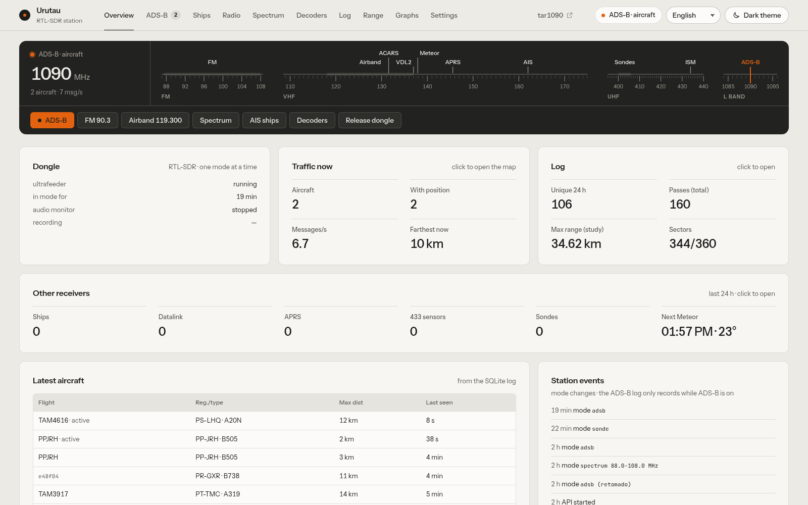
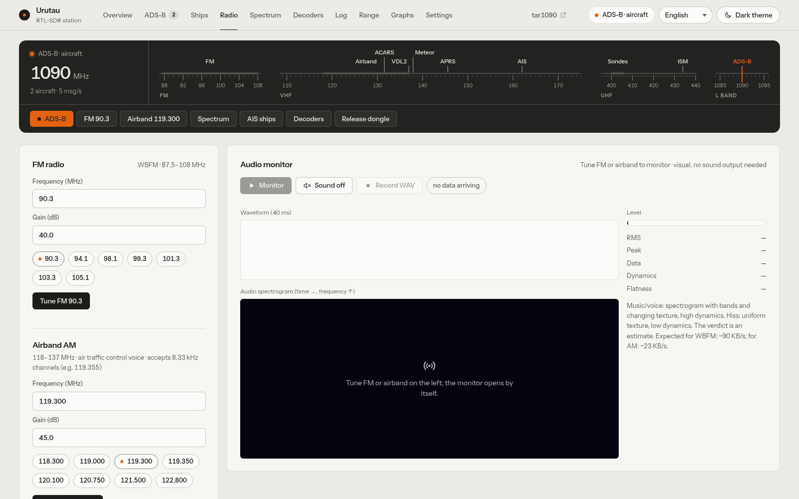
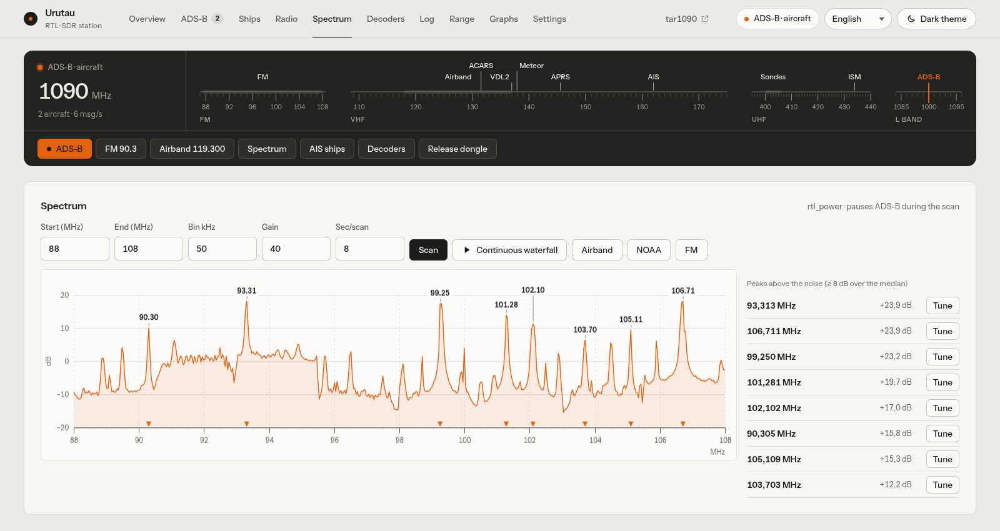
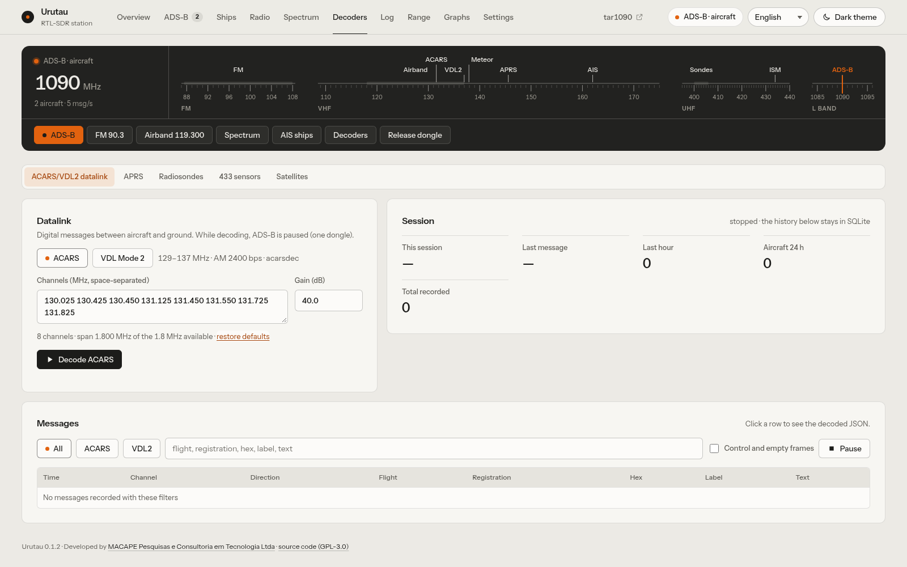
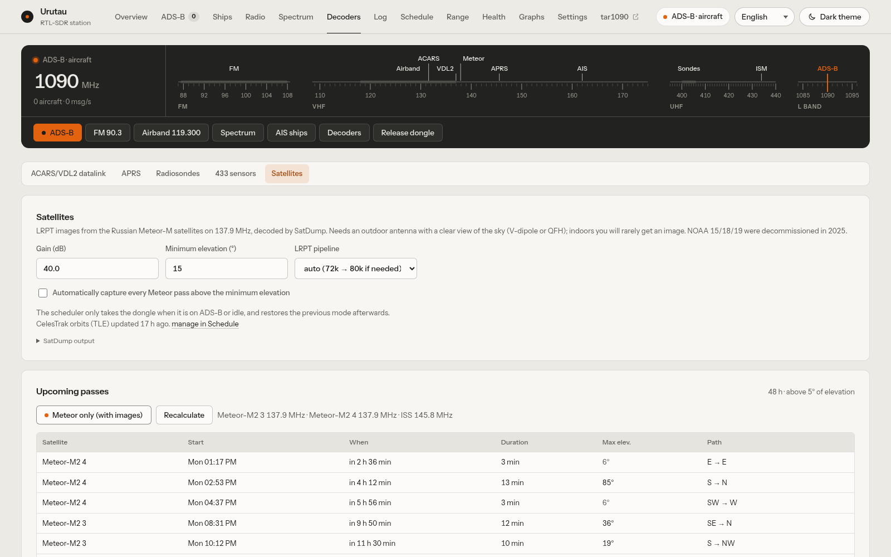
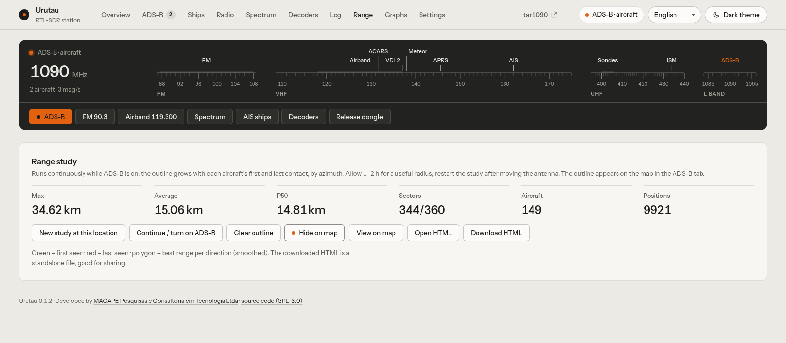

# Urutau

[](https://github.com/mateuspestana/urutau/releases)
[](https://github.com/mateuspestana/urutau/actions/workflows/ci.yml)
[](LICENSE)
[](https://github.com/mateuspestana/urutau/commits/main)

[Português](README.md) · **English** · [Español](README.es.md) · [Français](README.fr.md) · [Русский](README.ru.md)

Urutau is a home radio receiving station built around an RTL-SDR receiver. A single web panel brings together aircraft tracking (ADS-B) and ship tracking (AIS), FM broadcast and airband listening, spectrum analysis, decoding of digital messages (ACARS, VDL2, APRS), radiosonde tracking, wireless sensor readings and weather satellite imagery. It runs in Docker on Linux, on the Raspberry Pi and, experimentally, on Windows. All data stays on the user’s machine.

The name comes from the urutau, or common potoo (*Nyctibius griseus*), a bird that spends the night motionless, watching the sky.



## Motivation

An inexpensive RTL-SDR receiver covers 24 MHz to 1.7 GHz and picks up dozens of different services. Each service, however, needs its own program, usually command-line only, and only one of those programs can use the receiver at a time. There was no application that brought these tools together and arbitrated access to the receiver. Urutau fills that gap: the user picks a mode in the panel, and the system stops the previous process, releases the USB device and starts the right decoder.

The project is meant for anyone who wants to observe their own airspace and waters without relying on third-party services: researchers, schools, community groups, neighbourhood associations and radio listening enthusiasts.

## Features

| Module | What it does | Band |
|---|---|---|
| [ADS-B](#ads-b-aircraft) | Aircraft on a map, with registration, type, altitude, speed and trail | 1090 MHz |
| [FM radio](#fm-radio-and-rds) | Broadcast stations, with station name and text (RDS) | 87.5–108 MHz |
| [Airband](#airband) | Voice communications between pilots and air traffic control, in AM | 118–137 MHz |
| [Spectrum](#spectrum) | Sweep of any band, with each peak’s frequency labelled | 24–1700 MHz |
| [Ships (AIS)](#ships-ais) | Vessels with name, type, course, speed and destination | 161.975 and 162.025 MHz |
| [Datalink](#acars-and-vdl2-datalink) | ACARS and VDL2 digital messages between aircraft and ground stations | 129–137 MHz |
| [APRS](#aprs) | Positions, weather data and messages from radio amateurs | 144–146 MHz |
| [Radiosondes](#radiosondes) | Weather balloons with altitude, temperature, humidity and trajectory | 400–406 MHz |
| [ISM sensors](#ism-sensors-433-mhz) | Weather stations, thermometers and other wireless sensors | 433.92 MHz |
| [Satellites](#satellite-images-meteor-m) | Meteor-M satellite images and pass schedule | 137.9 MHz |

Beyond the receivers, the panel offers an [aircraft log](#aircraft-log), a [range study](#range-study), [performance graphs](#graphs), [markers](#markers) and an interface in [five languages](#languages-and-appearance).

### Panel and tuning scale

The top of the panel reproduces the dial of a radio receiver. Each service sits at its real frequency across four bands (FM, VHF, UHF and L band), and an orange pointer shows which mode currently holds the receiver. On the left, a display shows the current mode and frequency; below it, mode keys switch between services. Because the receiver serves one service at a time, every switch goes through the API, which stops the previous process before starting the next one. After a restart, the API automatically resumes the last mode chosen.

### ADS-B (aircraft)

Aircraft continuously broadcast their identification, position, altitude and speed on 1090 MHz. Urutau receives these signals with [readsb](https://github.com/wiedehopf/readsb) and shows them on a tar1090-style map:

- icons coloured by altitude and rotated by heading, with a trail for each flight;
- detail panel with registration, model, operator, speed, vertical rate, autopilot, wind and aircraft photo;
- sortable, filterable table of every aircraft received;
- alerts for emergency squawks (7500, 7600 and 7700);
- range rings, labels and a follow mode for the selected aircraft.

The full tar1090 map remains available at `http://localhost:8089`.

### FM radio and RDS

FM mode tunes broadcast stations in wideband (WBFM) and decodes RDS, the system through which a station broadcasts its name, programme type, free text, clock and alternative frequencies.

Since many computers and servers have no sound output, audio is presented visually, with an oscilloscope, a spectrogram, a dBFS level meter and an automatic content estimate (voice and music, hiss or silence). Playback in the browser is optional, and audio can be recorded as WAV.



### Airband

Airband mode receives, in AM, voice communications between pilots and air traffic control units (tower, approach, area control). It accepts 8.33 kHz channel spacing and uses the same visual audio monitor as FM mode.

### Spectrum

Spectrum analysis sweeps any frequency range with `rtl_power` and plots the received power. The horizontal axis is a graduated ruler, and every significant peak (8 dB above the median) is labelled with its frequency. Hovering shows the exact frequency and level. A continuous waterfall mode turns each sweep into a row coloured by intensity. Peaks in the FM or airband ranges can be tuned with one click.



### Ships (AIS)

Vessels broadcast identification, position, course, speed and destination through AIS. Urutau receives both AIS channels at once with [AIS-catcher](https://github.com/jvde-github/AIS-catcher) and shows the vessels on a map, grouped by category (cargo, tanker, passenger, fishing, pleasure craft, tugs, aids to navigation), with a trail and full record for each. Reception improves a lot with the antenna facing the sea, a bay or a navigable river.

### Decoders

The Decoders tab gathers the modes that turn digital signals into structured data. Each one has session counters, history in SQLite and the decoder’s output for troubleshooting.

#### ACARS and VDL2 datalink

ACARS and VDL Mode 2 are the data links through which aircraft and airlines exchange operational messages: positions, engine reports, clearances and CPDLC messages. Urutau decodes several channels at once (within a 1.8 MHz window) with [acarsdec](https://github.com/TLeconte/acarsdec) or [dumpvdl2](https://github.com/szpajder/dumpvdl2) and lists the messages with direction (ground or aircraft), flight, registration, label and text, plus the full JSON of each message.



#### APRS

APRS is the radio amateur network for positions, weather data and short messages. Urutau decodes packets with [multimon-ng](https://github.com/EliasOenal/multimon-ng) and parses them with aprslib. Stations appear on a map with their trail, symbol and comment. The default frequency is 145.570 MHz (Brazil); presets are available for 144.390 MHz (North America), 144.800 MHz (Europe) and 145.825 MHz (International Space Station).

#### Radiosondes

Radiosondes are weather balloons launched twice a day, around 00Z and 12Z, that transmit position, altitude, temperature, humidity and pressure until they burst above 30 km. Urutau runs [radiosonde_auto_rx](https://github.com/projecthorus/radiosonde_auto_rx) in its own container and maps each sonde with its trajectory. An optional schedule starts the search automatically during launch windows. Public upload to SondeHub stays off.

#### ISM sensors (433 MHz)

The 433.92 MHz ISM band carries home weather stations, thermometers, tyre pressure sensors (TPMS), doorbells and remote controls. Urutau uses [rtl_433](https://github.com/merbanan/rtl_433), which recognises more than 200 models, and organises readings by device, with message history.

#### Satellite images (Meteor-M)

The Russian Meteor-M weather satellites transmit live images of the Earth in LRPT format on 137.9 MHz. Urutau computes the passes for the next 48 hours from the orbits published by CelesTrak, with time, duration, maximum elevation and path. Captures are decoded by [SatDump](https://github.com/SatDump/SatDump) and shown in the panel. An optional schedule automatically captures every pass above a minimum elevation and returns the receiver to the previous mode afterwards. An outdoor antenna with a clear view of the sky (V-dipole or QFH) is needed to obtain images.

<!-- Image from a Meteor pass captured by the station: to be added. -->



### Aircraft log

Every aircraft received is logged in an SQLite database, including those that do not broadcast a position. Each pass produces one row, with time, duration, flight, registration, type, maximum altitude and distance, signal strength and trail. The log can be filtered by period and text, exported to CSV and viewed on the map. A station event history records mode changes, showing when ADS-B was off.

### Range study

While ADS-B is on, Urutau continuously measures the station’s range in 360 sectors of 1°, from each aircraft’s first and last contact. The resulting outline is smoothed (gap interpolation, circular median and Gaussian filter), so that a single aircraft does not create an artificial spike; the raw maximum remains available in the statistics. The outline can be shown on the map and exported as a standalone HTML report.



### Graphs

The Graphs tab shows the historical series produced by graphs1090: aircraft count, message rate, signal, range, CPU use, temperature and memory, over periods from 2 hours to 1 year.

### Markers

Frequencies and geographic points of interest can be saved as markers. Frequency markers are tuned with one click; position markers appear on the map.

### Languages and appearance

The interface is available in Portuguese (default), English, Spanish, French and Russian, with numbers and dates formatted for each language. There are light and dark themes, and the panel adapts to phone screens. The installer also speaks the five languages, following the system language.

## Requirements

- **RTL-SDR receiver.** The reference model is the [RTL-SDR Blog V4](https://www.rtl-sdr.com/v4/), sold with dipole antennas.
- **Computer:** Linux (Ubuntu, Debian, Fedora, Arch and derivatives), Raspberry Pi 4 or 5 with 64-bit Raspberry Pi OS, or Windows 10/11 with WSL2 (experimental).
- **Docker** with the Compose plugin.
- **An antenna suited to the service.** The antenna supplied with the receiver, used indoors, handles FM and nearby aircraft. Ships, satellites and radiosondes require an outdoor antenna, or one by a window with a view of the sky or the sea.

macOS is not supported: Docker on macOS gives containers no access to USB devices.

## Installation

### Linux and Raspberry Pi

```bash
git clone https://github.com/mateuspestana/urutau.git
cd urutau
./install.sh
```

The installer:

1. checks Docker and Docker Compose;
2. looks for the receiver and, if needed, offers to blacklist the kernel’s digital TV driver (`dvb_usb_rtl28xxu`), which often claims the device;
3. asks for the antenna location and who may open the panel: this machine only, the local network and Tailscale, or Tailscale only;
4. writes the `.env` file and starts the containers.

When it finishes, the panel is available at **http://localhost:3090**. For an unattended installation:

```bash
URUTAU_LAT=-15.799 URUTAU_LON=-47.864 URUTAU_LANG=en ./install.sh -y
```

The installer downloads prebuilt images for PCs (amd64) and the Raspberry Pi (arm64). When there is no image for the architecture, it builds locally; on a Raspberry Pi this can take more than an hour.

### Windows (experimental)

On Windows, Urutau runs inside WSL2, and the dongle is passed to Linux by [usbipd-win](https://github.com/dorssel/usbipd-win). The `install-windows.ps1` script automates the process. See the [Windows guide](docs/windows.en.md).

### Access over the local network and Tailscale

By default, the panel only opens on the computer itself. The installer offers three access options, stored as `URUTAU_BIND` in `.env`:

| Option | `URUTAU_BIND` | Who can access it |
|---|---|---|
| 1. This machine only (default) | `127.0.0.1` | only the station computer |
| 2. Local network and Tailscale | `0.0.0.0` | any device on the local network and on your [Tailscale](https://tailscale.com) network |
| 3. Tailscale only | the machine’s `100.x.y.z` IP | only devices on your Tailscale network |

With options 2 or 3, open `http://<station-address>:3090` on another device (for example, the machine’s Tailscale name or IP). Links to tar1090 and to the graphs automatically follow the address in use. With option 3, Tailscale must be connected before Docker starts. Anyone who can open the panel can also change the receiver mode, and the API controls the machine’s Docker: only allow access on trusted networks.

To change the option later, run `./install.sh` again, or edit `URUTAU_BIND` in `.env` and run `docker compose up -d`.

## Operation

| Action | Command |
|---|---|
| Stop the station | `docker compose stop` |
| Start it again | `docker compose start` |
| Update | `git pull && ./install.sh` |
| View API logs | `docker compose logs -f api` |
| API documentation | http://localhost:8000/docs |

The antenna location can be changed at any time in the Settings tab. Three decimal places (about 100 m) are enough for the range study.

## Privacy and external connections

The panel is only reachable from the computer itself (`127.0.0.1`), unless access over the local network or Tailscale is allowed (see [Access over the local network and Tailscale](#access-over-the-local-network-and-tailscale)). No reception data is sent to third parties: sharing with tracking networks (ADS-B Exchange, FlightAware and the like) and radiosonde upload to SondeHub are off by default.

The panel only connects to the internet to obtain information that cannot be produced locally:

| Purpose | Service | Data sent |
|---|---|---|
| Satellite orbits | CelesTrak | satellite number (once a day) |
| Map background | Esri (ArcGIS) | the map area being viewed |
| Aircraft registration and type | database shipped with tar1090 | prefix of the aircraft code |
| Aircraft photo, when one is selected | planespotters.net | aircraft code and registration |
| HTML range report, when opened | unpkg | request for the Leaflet map library |

Fonts and other panel assets ship with the software. The antenna location is kept only in the `.env` file and the local Docker volume.

## Architecture

```
USB receiver ─► ultrafeeder (readsb, tar1090, graphs1090) ─► ADS-B
             └► API (FastAPI) ─ rtl_fm, rtl_power, AIS-catcher, acarsdec, dumpvdl2,
                                rtl_433, multimon-ng, redsea, SatDump, radiosonde_auto_rx
                   │
                   └─► web panel (React + Vite, served by nginx) on :3090
```

The API alone is responsible for the receiver. On each mode change it stops the previous process, stops or starts the ultrafeeder through Docker, and only then starts the new decoder. Records are kept in SQLite databases in the `urutau_api_data` volume. Development instructions are in [CONTRIBUTING.md](CONTRIBUTING.md).

## Troubleshooting

- **`usb_claim_interface error -6`:** another program is using the receiver. It may be the kernel’s digital TV driver (run `./install.sh` again) or an external program such as GQRX or `rtl_*`. Before using another program, stop the station with `docker compose stop`.
- **Panel open, but no aircraft:** with an indoor antenna, receiving few or no aircraft is normal. To check the receiver, tune an FM station: if the audio monitor shows a signal, the hardware works.
- **Permission denied on Docker:** check that `DOCKER_GID` in `.env` matches the output of `getent group docker`.
- **No satellite passes:** set the location in Settings and make sure the container can reach the internet to fetch the orbits.

## Legal notice

Receiving openly broadcast signals (ADS-B, AIS, FM, APRS, radiosondes and weather satellites) is a common radio listening practice. Voice communications and datalink messages are not intended for the public: use them for study only and do not disclose their content. Each user is responsible for complying with the laws of their country.

## Credits

Urutau builds on the work of many open-source projects: [docker-adsb-ultrafeeder](https://github.com/sdr-enthusiasts/docker-adsb-ultrafeeder) (readsb, tar1090 and graphs1090), [AIS-catcher](https://github.com/jvde-github/AIS-catcher), [acarsdec](https://github.com/TLeconte/acarsdec), [dumpvdl2](https://github.com/szpajder/dumpvdl2) and [libacars](https://github.com/szpajder/libacars), [rtl_433](https://github.com/merbanan/rtl_433), [multimon-ng](https://github.com/EliasOenal/multimon-ng), [redsea](https://github.com/windytan/redsea), [SatDump](https://github.com/SatDump/SatDump), [radiosonde_auto_rx](https://github.com/projecthorus/radiosonde_auto_rx), [Skyfield](https://rhodesmill.org/skyfield/) and [osmocom rtl-sdr](https://osmocom.org/projects/rtl-sdr).

## How to cite

Citation metadata is in [CITATION.cff](CITATION.cff). On GitHub, use the *Cite this repository* button.

## License

Distributed under the [GNU General Public License v3.0](LICENSE) (GPL-3.0-only).

---

Developed by [MACAPE Pesquisas e Consultoria em Tecnologia Ltda](https://macape.dev).
