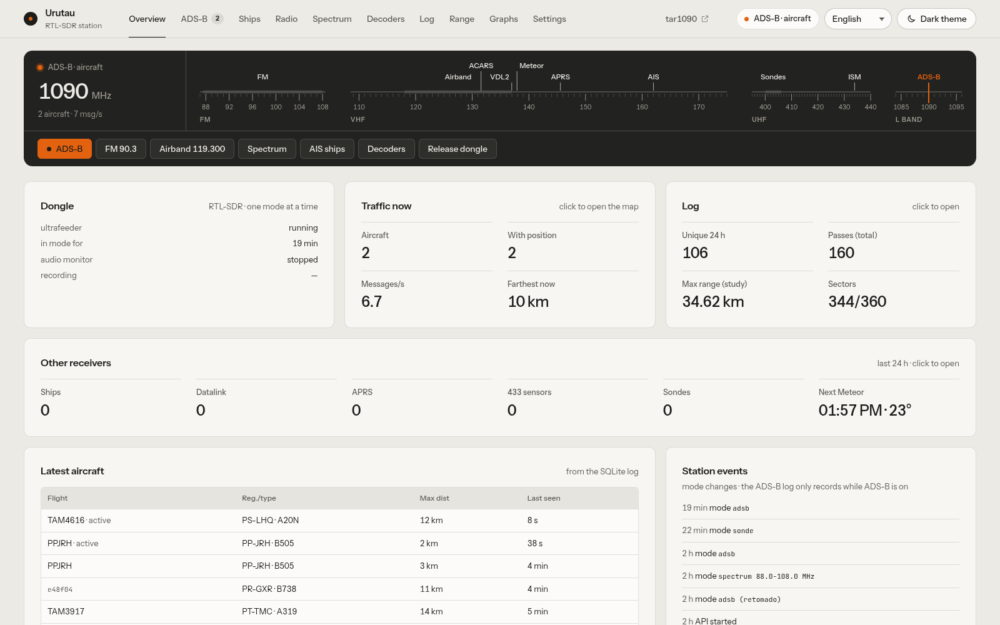
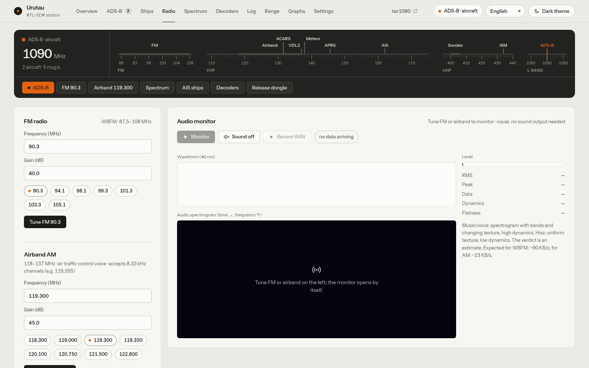
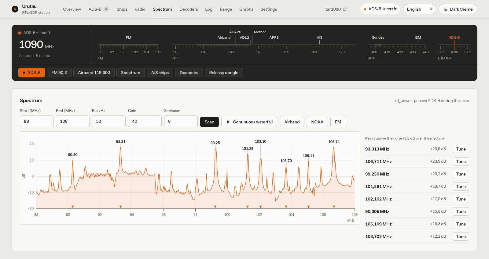
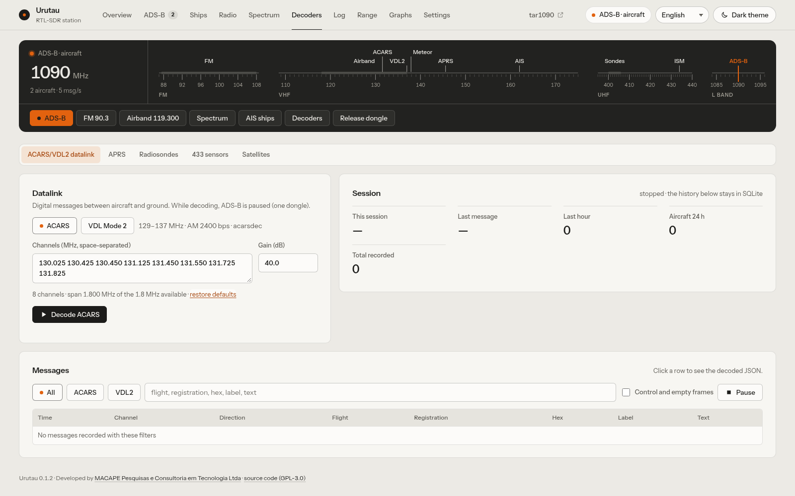
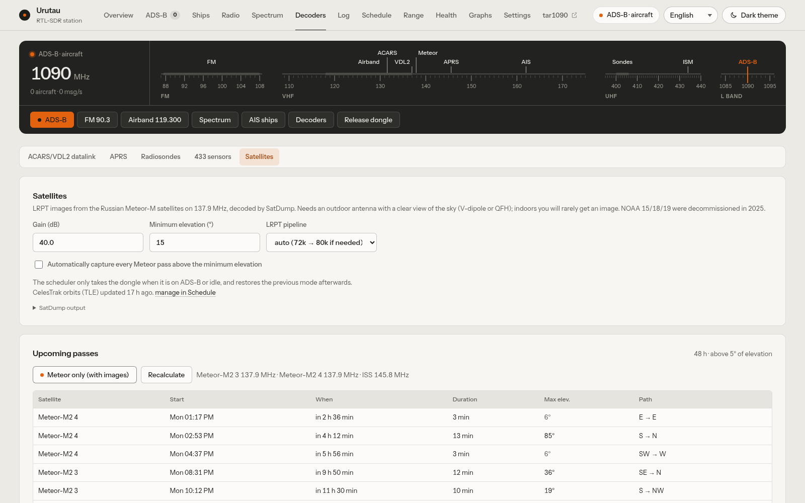
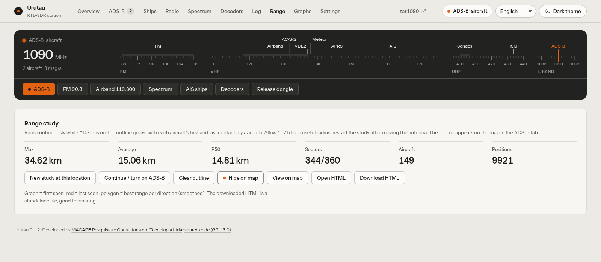

# Urutau

[](https://github.com/mateuspestana/urutau/releases)
[](https://github.com/mateuspestana/urutau/actions/workflows/ci.yml)
[](LICENSE)
[](https://github.com/mateuspestana/urutau/commits/main)

[Português](README.md) · [English](README.en.md) · **Español** · [Français](README.fr.md) · [Русский](README.ru.md)

Urutau es una estación de recepción de radio para uso doméstico basada en un receptor RTL-SDR. En un único panel web reúne el seguimiento de aeronaves (ADS-B) y de barcos (AIS), la escucha de radio FM y de la banda aeronáutica, el análisis de espectro, la decodificación de mensajes digitales (ACARS, VDL2, APRS), el seguimiento de radiosondas, la lectura de sensores inalámbricos y la recepción de imágenes de satélites meteorológicos. Funciona en Docker sobre Linux, en la Raspberry Pi y, de forma experimental, en Windows. Todos los datos permanecen en la máquina del usuario.

El nombre viene del urutaú (*Nyctibius griseus*), un ave que pasa la noche inmóvil observando el cielo.



## Motivación

Un receptor RTL-SDR de bajo costo cubre de 24 MHz a 1,7 GHz y capta decenas de servicios distintos. Sin embargo, cada servicio depende de un programa propio, normalmente de línea de comandos, y solo uno de esos programas puede usar el receptor a la vez. No existía una aplicación que reuniera estas herramientas y arbitrara el acceso al receptor. Urutau cubre ese vacío: el usuario elige el modo en el panel y el sistema detiene el proceso anterior, libera el dispositivo USB e inicia el decodificador adecuado.

El proyecto está pensado para quien quiera observar su propio espacio aéreo y marítimo sin depender de servicios de terceros: investigadores, escuelas, colectivos, asociaciones vecinales y aficionados a la radioescucha.

## Funcionalidades

| Módulo | Qué hace | Banda |
|---|---|---|
| [ADS-B](#ads-b-aeronaves) | Aeronaves en el mapa, con matrícula, tipo, altitud, velocidad y traza | 1090 MHz |
| [Radio FM](#radio-fm-y-rds) | Emisoras comerciales, con nombre y texto de la emisora (RDS) | 87,5–108 MHz |
| [Banda aeronáutica](#banda-aeronáutica) | Comunicaciones de voz entre pilotos y control de tránsito aéreo, en AM | 118–137 MHz |
| [Espectro](#espectro) | Barrido de cualquier banda, con la frecuencia de cada pico identificada | 24–1700 MHz |
| [Barcos (AIS)](#barcos-ais) | Embarcaciones con nombre, tipo, rumbo, velocidad y destino | 161,975 y 162,025 MHz |
| [Enlace de datos](#enlace-de-datos-acars-y-vdl2) | Mensajes digitales ACARS y VDL2 entre aeronaves y estaciones terrestres | 129–137 MHz |
| [APRS](#aprs) | Posiciones, datos meteorológicos y mensajes de radioaficionados | 144–146 MHz |
| [Radiosondas](#radiosondas) | Globos meteorológicos con altitud, temperatura, humedad y trayectoria | 400–406 MHz |
| [Sensores ISM](#sensores-ism-433-mhz) | Estaciones meteorológicas, termómetros y otros sensores inalámbricos | 433,92 MHz |
| [Satélites](#imágenes-de-satélite-meteor-m) | Imágenes de los satélites Meteor-M y agenda de pases | 137,9 MHz |

Además de los receptores, el panel ofrece [registro de aeronaves](#registro-de-aeronaves), [estudio de alcance](#estudio-de-alcance), [gráficos de rendimiento](#gráficos), [marcadores](#marcadores) e interfaz en [cinco idiomas](#idiomas-y-apariencia).

### Panel y escala de sintonía

La parte superior del panel reproduce la escala de un receptor de radio. Cada servicio aparece en su frecuencia real, repartido en cuatro bandas (FM, VHF, UHF y banda L), y una aguja naranja indica qué modo tiene el receptor en ese momento. A la izquierda, un indicador muestra el modo y la frecuencia actuales; debajo, las teclas de modo permiten cambiar de servicio. Como el receptor atiende un servicio a la vez, cada cambio lo hace la propia API, que detiene el proceso anterior antes de iniciar el nuevo. Tras un reinicio, la API retoma automáticamente el último modo elegido.

### ADS-B (aeronaves)

Las aeronaves transmiten continuamente, en 1090 MHz, su identificación, posición, altitud y velocidad. Urutau recibe estas señales con [readsb](https://github.com/wiedehopf/readsb) y las muestra en un mapa al estilo de tar1090:

- iconos coloreados según la altitud y orientados según el rumbo, con la traza de cada vuelo;
- panel de detalles con matrícula, modelo, operador, velocidad, régimen de ascenso, piloto automático, viento y foto de la aeronave;
- tabla ordenable y filtrable de todas las aeronaves recibidas;
- alerta de códigos de emergencia (7500, 7600 y 7700);
- anillos de distancia, etiquetas y seguimiento de la aeronave seleccionada.

El mapa completo de tar1090 sigue disponible en `http://localhost:8089`.

### Radio FM y RDS

El modo FM sintoniza emisoras comerciales en banda ancha (WBFM) y decodifica el RDS, el sistema con el que la emisora transmite su nombre, tipo de programa, texto libre, hora y frecuencias alternativas.

Como muchos ordenadores y servidores no tienen salida de sonido, el audio se presenta de forma visual, con osciloscopio, espectrograma, medidor de nivel en dBFS y una estimación automática del contenido (voz y música, siseo o silencio). La reproducción en el navegador es opcional, y el audio puede grabarse en WAV.



### Banda aeronáutica

El modo de banda aeronáutica recibe, en AM, las comunicaciones de voz entre pilotos y dependencias de control (torre, aproximación, centro de control). Admite canales con separación de 8,33 kHz y usa el mismo monitor visual de audio que el modo FM.

### Espectro

El análisis de espectro barre cualquier intervalo de frecuencias con `rtl_power` y dibuja la potencia recibida. El eje horizontal es una regla graduada, y cada pico significativo (8 dB por encima de la mediana) se etiqueta con su frecuencia. Al pasar el cursor, el gráfico muestra la frecuencia y el nivel exactos. Existe además un modo de cascada continua, en el que cada barrido se convierte en una fila coloreada según la intensidad. Los picos de las bandas FM o aeronáutica pueden sintonizarse con un clic.



### Barcos (AIS)

Las embarcaciones transmiten, mediante el sistema AIS, su identificación, posición, rumbo, velocidad y destino. Urutau recibe los dos canales AIS a la vez con [AIS-catcher](https://github.com/jvde-github/AIS-catcher) y muestra las embarcaciones en un mapa, clasificadas por categoría (carga, petroleros, pasajeros, pesca, recreo, remolcadores, ayudas a la navegación), con traza y ficha completa de cada una. La recepción mejora mucho con la antena orientada al mar, a una bahía o a un río navegable.

### Decodificadores

La pestaña Decodificadores reúne los modos que convierten señales digitales en datos estructurados. Cada uno tiene contadores de sesión, historial en SQLite y la salida del programa decodificador para diagnóstico.

#### Enlace de datos ACARS y VDL2

ACARS y VDL Modo 2 son los enlaces de datos con los que aeronaves y aerolíneas intercambian mensajes operativos: posiciones, informes de motor, autorizaciones y mensajes CPDLC. Urutau decodifica varios canales a la vez (dentro de una ventana de 1,8 MHz) con [acarsdec](https://github.com/TLeconte/acarsdec) o [dumpvdl2](https://github.com/szpajder/dumpvdl2) y presenta los mensajes con sentido (tierra o aeronave), vuelo, matrícula, etiqueta y texto, además del JSON completo de cada mensaje.



#### APRS

APRS es la red de radioaficionados para posiciones, datos meteorológicos y mensajes cortos. Urutau decodifica los paquetes con [multimon-ng](https://github.com/EliasOenal/multimon-ng) y los interpreta con aprslib. Las estaciones aparecen en un mapa con su traza, símbolo y comentario. La frecuencia predeterminada es 145,570 MHz (Brasil); hay preajustes para 144,390 MHz (Norteamérica), 144,800 MHz (Europa) y 145,825 MHz (Estación Espacial Internacional).

#### Radiosondas

Las radiosondas son globos meteorológicos que se lanzan dos veces al día, hacia las 00Z y las 12Z, y transmiten posición, altitud, temperatura, humedad y presión hasta estallar por encima de los 30 km. Urutau ejecuta [radiosonde_auto_rx](https://github.com/projecthorus/radiosonde_auto_rx) en un contenedor propio y muestra en el mapa cada sonda con su trayectoria. Una agenda opcional activa la búsqueda automáticamente en las ventanas de lanzamiento. El envío público de datos a SondeHub permanece desactivado.

#### Sensores ISM (433 MHz)

En la banda ISM de 433,92 MHz operan estaciones meteorológicas domésticas, termómetros, sensores de presión de neumáticos (TPMS), timbres y mandos a distancia. Urutau utiliza [rtl_433](https://github.com/merbanan/rtl_433), que reconoce más de 200 modelos, y organiza las lecturas por dispositivo, con historial de mensajes.

#### Imágenes de satélite (Meteor-M)

Los satélites meteorológicos rusos Meteor-M transmiten imágenes de la Tierra en tiempo real en formato LRPT, en 137,9 MHz. Urutau calcula los pases de las próximas 48 horas a partir de las órbitas que publica CelesTrak, con hora, duración, elevación máxima y trayectoria. Las capturas se decodifican con [SatDump](https://github.com/SatDump/SatDump) y quedan disponibles en el panel. Una agenda opcional captura automáticamente cada pase por encima de una elevación mínima y devuelve el receptor al modo anterior al terminar. Para obtener imágenes se necesita una antena exterior con vista despejada del cielo (dipolo en V o QFH).

<!-- Imagen de un pase de Meteor capturado por la estación: pendiente. -->



### Registro de aeronaves

Cada aeronave recibida se registra en una base SQLite, incluidas las que no transmiten posición. Cada paso genera una fila con hora, duración, vuelo, matrícula, tipo, altitud y distancia máximas, intensidad de señal y traza. El registro puede filtrarse por período y por texto, exportarse a CSV y consultarse en el mapa. Un historial de eventos de la estación registra los cambios de modo, lo que permite saber en qué períodos ADS-B estuvo apagado.

### Estudio de alcance

Mientras ADS-B está activo, Urutau mide de forma continua el alcance de la estación en 360 sectores de 1°, a partir del primer y el último contacto de cada aeronave. El contorno resultante se suaviza (interpolación de huecos, mediana circular y filtro gaussiano) para que una aeronave aislada no produzca un pico artificial; el máximo bruto sigue disponible en las estadísticas. El contorno puede mostrarse en el mapa y exportarse como un informe HTML autónomo.



### Gráficos

La pestaña Gráficos muestra las series históricas generadas por graphs1090: número de aeronaves, tasa de mensajes, señal, alcance, uso de CPU, temperatura y memoria, en períodos de 2 horas a 1 año.

### Marcadores

Las frecuencias y los puntos geográficos de interés pueden guardarse como marcadores. Los marcadores de frecuencia se sintonizan con un clic; los de posición aparecen en el mapa.

### Idiomas y apariencia

La interfaz está disponible en portugués (predeterminado), inglés, español, francés y ruso, con números y fechas en el formato de cada idioma. Hay temas claro y oscuro, y el panel se adapta a pantallas de móvil. El instalador también habla los cinco idiomas, según el idioma del sistema.

## Requisitos

- **Receptor RTL-SDR.** El modelo de referencia es el [RTL-SDR Blog V4](https://www.rtl-sdr.com/v4/), que se vende con antenas dipolo.
- **Ordenador:** Linux (Ubuntu, Debian, Fedora, Arch y derivados), Raspberry Pi 4 o 5 con Raspberry Pi OS de 64 bits, o Windows 10/11 con WSL2 (experimental).
- **Docker** con el plugin Compose.
- **Una antena adecuada al servicio.** La antena que viene con el receptor, en interiores, sirve para FM y aeronaves cercanas. Barcos, satélites y radiosondas requieren una antena exterior o junto a una ventana, con vista al cielo o al mar.

macOS no está soportado: Docker en macOS no da acceso a dispositivos USB.

## Instalación

### Linux y Raspberry Pi

```bash
git clone https://github.com/mateuspestana/urutau.git
cd urutau
./install.sh
```

El instalador:

1. comprueba Docker y Docker Compose;
2. busca el receptor y, si hace falta, ofrece bloquear el driver de TV digital del kernel (`dvb_usb_rtl28xxu`), que suele ocupar el dispositivo;
3. pregunta la ubicación de la antena y quién puede abrir el panel: solo esta máquina, la red local y Tailscale, o solo Tailscale;
4. escribe el archivo `.env` e inicia los contenedores.

Al terminar, el panel queda disponible en **http://localhost:3090**. Para una instalación no interactiva:

```bash
URUTAU_LAT=-15.799 URUTAU_LON=-47.864 URUTAU_LANG=es ./install.sh -y
```

El instalador descarga imágenes listas para PC (amd64) y Raspberry Pi (arm64). Si no hay imagen para la arquitectura, compila localmente; en una Raspberry Pi esto puede tardar más de una hora.

### Windows (experimental)

En Windows, Urutau funciona dentro de WSL2, y el dongle se pasa a Linux mediante [usbipd-win](https://github.com/dorssel/usbipd-win). El script `install-windows.ps1` automatiza el proceso. Consulta la [guía para Windows (en inglés)](docs/windows.en.md).

### Acceso desde la red local y Tailscale

De forma predeterminada, el panel solo se abre en el propio ordenador. El instalador ofrece tres opciones de acceso, que se guardan como `URUTAU_BIND` en el `.env`:

| Opción | `URUTAU_BIND` | Quién accede |
|---|---|---|
| 1. Solo esta máquina (predeterminado) | `127.0.0.1` | solo el ordenador de la estación |
| 2. Red local y Tailscale | `0.0.0.0` | cualquier dispositivo de la red local y de tu red [Tailscale](https://tailscale.com) |
| 3. Solo Tailscale | IP `100.x.y.z` de la máquina | solo dispositivos de tu red Tailscale |

Con las opciones 2 o 3, abre `http://<dirección-de-la-estación>:3090` en otro dispositivo (por ejemplo, el nombre o la IP de la máquina en Tailscale). Los enlaces a tar1090 y a los gráficos siguen automáticamente la dirección utilizada. Con la opción 3, Tailscale debe estar conectado antes de que arranque Docker. Quien puede abrir el panel también puede cambiar el modo del receptor, y la API controla el Docker de la máquina: permite el acceso solo en redes de confianza.

Para cambiar la opción más adelante, vuelve a ejecutar `./install.sh`, o edita `URUTAU_BIND` en el `.env` y ejecuta `docker compose up -d`.

## Operación

| Acción | Comando |
|---|---|
| Detener la estación | `docker compose stop` |
| Volver a iniciarla | `docker compose start` |
| Actualizar | `git pull && ./install.sh` |
| Ver los registros de la API | `docker compose logs -f api` |
| Documentación de la API | http://localhost:8000/docs |

La ubicación de la antena puede cambiarse en cualquier momento en la pestaña Ajustes. Tres decimales (unos 100 m) bastan para el estudio de alcance.

## Privacidad y conexiones externas

El panel solo es accesible desde el propio ordenador (`127.0.0.1`), salvo que se autorice el acceso desde la red local o Tailscale (consulta [Acceso desde la red local y Tailscale](#acceso-desde-la-red-local-y-tailscale)). Ningún dato de recepción se envía a terceros: el intercambio con redes de seguimiento (ADS-B Exchange, FlightAware y similares) y el envío de radiosondas a SondeHub vienen desactivados.

El panel solo se conecta a internet para obtener información que no puede generarse localmente:

| Finalidad | Servicio | Dato enviado |
|---|---|---|
| Órbitas de los satélites | CelesTrak | número del satélite (una vez al día) |
| Fondo del mapa | Esri (ArcGIS) | zona del mapa mostrada |
| Matrícula y tipo de las aeronaves | base de datos distribuida con tar1090 | prefijo del código de la aeronave |
| Foto de la aeronave, al seleccionarla | planespotters.net | código y matrícula de la aeronave |
| Informe de alcance en HTML, al abrirlo | unpkg | solicitud de la biblioteca de mapas Leaflet |

Las fuentes y demás recursos del panel se distribuyen con el propio software. La ubicación de la antena se guarda solo en el archivo `.env` y en el volumen Docker local.

## Arquitectura

```
receptor USB ─► ultrafeeder (readsb, tar1090, graphs1090) ─► ADS-B
             └► API (FastAPI) ─ rtl_fm, rtl_power, AIS-catcher, acarsdec, dumpvdl2,
                                rtl_433, multimon-ng, redsea, SatDump, radiosonde_auto_rx
                   │
                   └─► panel web (React + Vite, servido por nginx) en :3090
```

La API es la única responsable del receptor. En cada cambio de modo detiene el proceso anterior, detiene o inicia el ultrafeeder mediante Docker y solo entonces inicia el nuevo decodificador. Los registros se guardan en bases SQLite en el volumen `urutau_api_data`. Las instrucciones de desarrollo están en [CONTRIBUTING.md](CONTRIBUTING.md).

## Solución de problemas

- **`usb_claim_interface error -6`:** otro programa está usando el receptor. Puede ser el driver de TV digital del kernel (vuelve a ejecutar `./install.sh`) o un programa externo como GQRX o `rtl_*`. Antes de usar otro programa, detén la estación con `docker compose stop`.
- **Panel abierto, pero ninguna aeronave:** con antena interior es normal recibir pocas aeronaves o ninguna. Para comprobar el receptor, sintoniza una emisora FM: si el monitor de audio muestra señal, el hardware funciona.
- **Permiso denegado al acceder a Docker:** comprueba que `DOCKER_GID` en `.env` coincide con el resultado de `getent group docker`.
- **Satélites sin pases:** define la ubicación en Ajustes y comprueba que el contenedor tiene acceso a internet para obtener las órbitas.

## Aviso legal

La recepción de señales transmitidas abiertamente (ADS-B, AIS, FM, APRS, radiosondas y satélites meteorológicos) es una práctica habitual de radioescucha. Las comunicaciones de voz y los mensajes de enlace de datos no están destinados al público: deben usarse solo con fines de estudio, sin divulgar su contenido. Cada usuario es responsable de cumplir la legislación de su país.

## Créditos

Urutau integra el trabajo de muchos proyectos de código abierto: [docker-adsb-ultrafeeder](https://github.com/sdr-enthusiasts/docker-adsb-ultrafeeder) (readsb, tar1090 y graphs1090), [AIS-catcher](https://github.com/jvde-github/AIS-catcher), [acarsdec](https://github.com/TLeconte/acarsdec), [dumpvdl2](https://github.com/szpajder/dumpvdl2) y [libacars](https://github.com/szpajder/libacars), [rtl_433](https://github.com/merbanan/rtl_433), [multimon-ng](https://github.com/EliasOenal/multimon-ng), [redsea](https://github.com/windytan/redsea), [SatDump](https://github.com/SatDump/SatDump), [radiosonde_auto_rx](https://github.com/projecthorus/radiosonde_auto_rx), [Skyfield](https://rhodesmill.org/skyfield/) y [osmocom rtl-sdr](https://osmocom.org/projects/rtl-sdr).

## Cómo citar

Los metadatos de cita están en [CITATION.cff](CITATION.cff). En GitHub, usa el botón *Cite this repository*.

## Licencia

Distribuido bajo la [GNU General Public License v3.0](LICENSE) (GPL-3.0-only).

---

Desarrollado por [MACAPE Pesquisas e Consultoria em Tecnologia Ltda](https://macape.dev).
