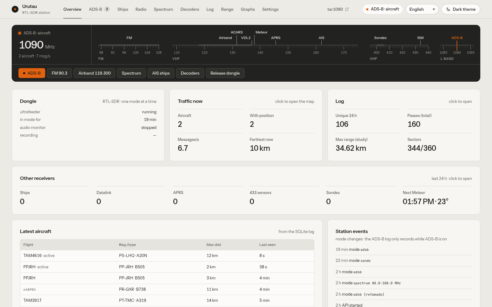
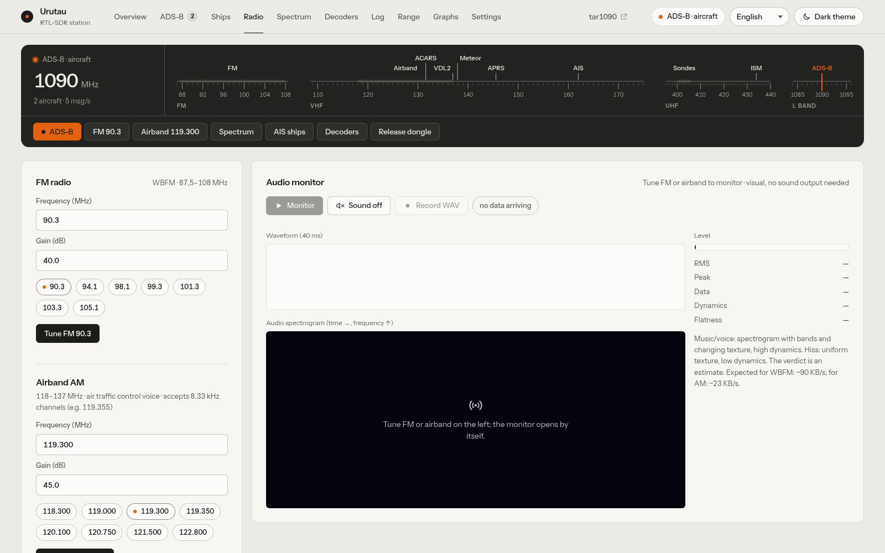
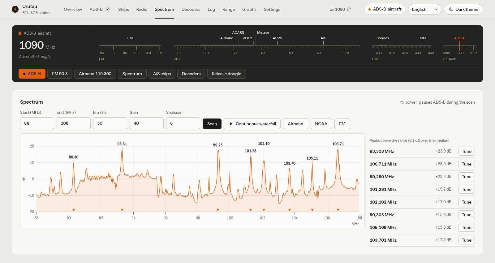
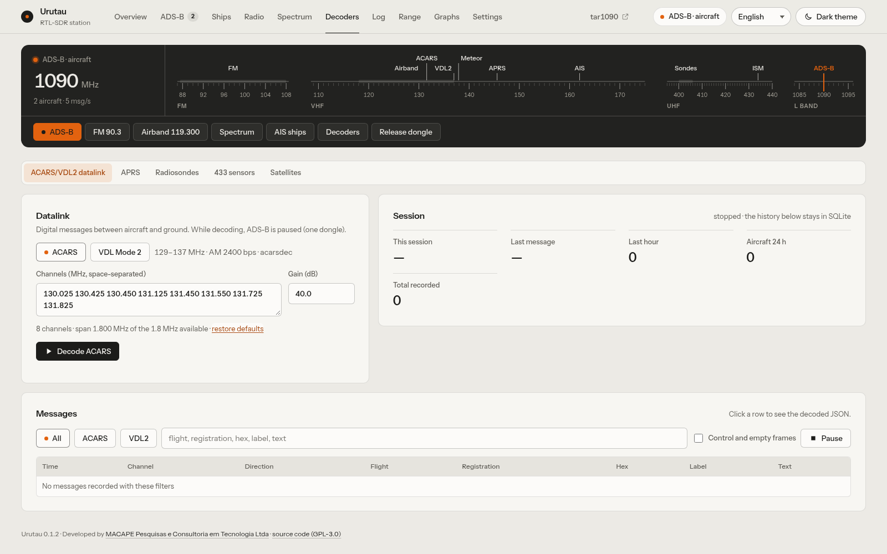
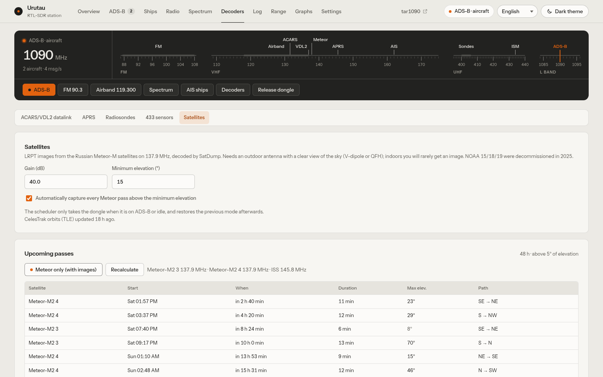
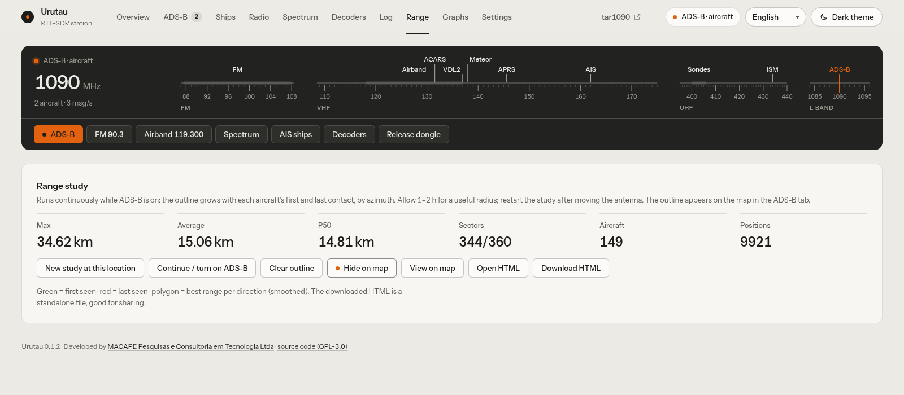

# Urutau

[](https://github.com/mateuspestana/urutau/releases)
[](https://github.com/mateuspestana/urutau/actions/workflows/ci.yml)
[](LICENSE)
[](https://github.com/mateuspestana/urutau/commits/main)

[Português](README.md) · [English](README.en.md) · [Español](README.es.md) · **Français** · [Русский](README.ru.md)

Urutau est une station de réception radio à usage domestique, construite autour d’un récepteur RTL-SDR. Un panneau web unique réunit le suivi des aéronefs (ADS-B) et des navires (AIS), l’écoute de la radio FM et de la bande aviation, l’analyse de spectre, le décodage de messages numériques (ACARS, VDL2, APRS), le suivi des radiosondes, la lecture de capteurs sans fil et la réception d’images de satellites météorologiques. Il fonctionne sous Docker sur Linux, sur Raspberry Pi et, à titre expérimental, sous Windows. Toutes les données restent sur la machine de l’utilisateur.

Le nom vient de l’urutau, ou ibijau gris (*Nyctibius griseus*), un oiseau qui passe la nuit immobile à observer le ciel.



## Motivation

Un récepteur RTL-SDR bon marché couvre de 24 MHz à 1,7 GHz et capte des dizaines de services différents. Chaque service dépend toutefois de son propre programme, le plus souvent en ligne de commande, et un seul de ces programmes peut utiliser le récepteur à la fois. Il n’existait aucune application qui réunisse ces outils et arbitre l’accès au récepteur. Urutau comble ce manque : l’utilisateur choisit un mode dans le panneau, et le système arrête le processus précédent, libère le périphérique USB et lance le décodeur approprié.

Le projet s’adresse à toute personne qui souhaite observer son propre espace aérien et maritime sans dépendre de services tiers : chercheurs, écoles, collectifs, associations de quartier et passionnés d’écoute radio.

## Fonctionnalités

| Module | Rôle | Bande |
|---|---|---|
| [ADS-B](#ads-b-aéronefs) | Aéronefs sur la carte, avec immatriculation, type, altitude, vitesse et trace | 1090 MHz |
| [Radio FM](#radio-fm-et-rds) | Stations de radiodiffusion, avec nom et texte de la station (RDS) | 87,5–108 MHz |
| [Bande aviation](#bande-aviation) | Communications vocales entre pilotes et contrôle aérien, en AM | 118–137 MHz |
| [Spectre](#spectre) | Balayage de n’importe quelle bande, avec la fréquence de chaque pic indiquée | 24–1700 MHz |
| [Navires (AIS)](#navires-ais) | Navires avec nom, type, route, vitesse et destination | 161,975 et 162,025 MHz |
| [Liaison de données](#liaison-de-données-acars-et-vdl2) | Messages numériques ACARS et VDL2 entre aéronefs et stations sol | 129–137 MHz |
| [APRS](#aprs) | Positions, données météo et messages de radioamateurs | 144–146 MHz |
| [Radiosondes](#radiosondes) | Ballons météo avec altitude, température, humidité et trajectoire | 400–406 MHz |
| [Capteurs ISM](#capteurs-ism-433-mhz) | Stations météo, thermomètres et autres capteurs sans fil | 433,92 MHz |
| [Satellites](#images-satellite-meteor-m) | Images des satellites Meteor-M et calendrier des passages | 137,9 MHz |

Outre les récepteurs, le panneau propose un [journal des aéronefs](#journal-des-aéronefs), une [étude de portée](#étude-de-portée), des [graphiques de performance](#graphiques), des [repères](#repères) et une interface en [cinq langues](#langues-et-apparence).

### Panneau et échelle d’accord

Le haut du panneau reproduit le cadran d’un récepteur radio. Chaque service se trouve à sa fréquence réelle, sur quatre bandes (FM, VHF, UHF et bande L), et une aiguille orange indique le mode qui occupe le récepteur à cet instant. À gauche, un afficheur indique le mode et la fréquence actuels ; en dessous, des touches de mode permettent de changer de service. Comme le récepteur ne sert qu’un service à la fois, chaque changement passe par l’API, qui arrête le processus précédent avant de lancer le suivant. Après un redémarrage, l’API reprend automatiquement le dernier mode choisi.

### ADS-B (aéronefs)

Les aéronefs diffusent en continu, sur 1090 MHz, leur identification, leur position, leur altitude et leur vitesse. Urutau reçoit ces signaux avec [readsb](https://github.com/wiedehopf/readsb) et les affiche sur une carte inspirée de tar1090 :

- icônes colorées selon l’altitude et orientées selon le cap, avec la trace de chaque vol ;
- panneau de détails avec immatriculation, modèle, exploitant, vitesse, taux de montée, pilote automatique, vent et photo de l’appareil ;
- tableau triable et filtrable de tous les aéronefs reçus ;
- alerte sur les codes d’urgence (7500, 7600 et 7700) ;
- cercles de distance, étiquettes et suivi de l’aéronef sélectionné.

La carte complète de tar1090 reste disponible à l’adresse `http://localhost:8089`.

### Radio FM et RDS

Le mode FM accorde les stations de radiodiffusion en large bande (WBFM) et décode le RDS, système par lequel la station transmet son nom, le type de programme, un texte libre, l’heure et les fréquences alternatives.

Comme beaucoup d’ordinateurs et de serveurs n’ont pas de sortie son, l’audio est présenté visuellement, avec un oscilloscope, un spectrogramme, un indicateur de niveau en dBFS et une estimation automatique du contenu (voix et musique, souffle ou silence). La lecture dans le navigateur est facultative, et l’audio peut être enregistré en WAV.



### Bande aviation

Le mode bande aviation reçoit, en AM, les communications vocales entre pilotes et organismes de contrôle (tour, approche, centre en route). Il accepte l’espacement de canaux de 8,33 kHz et utilise le même moniteur audio visuel que le mode FM.

### Spectre

L’analyse de spectre balaie n’importe quelle plage de fréquences avec `rtl_power` et trace la puissance reçue. L’axe horizontal est une règle graduée, et chaque pic significatif (8 dB au-dessus de la médiane) porte une étiquette avec sa fréquence. Au survol, le graphique affiche la fréquence et le niveau exacts. Un mode cascade continue transforme chaque balayage en une ligne colorée selon l’intensité. Les pics des bandes FM ou aviation peuvent être accordés d’un clic.



### Navires (AIS)

Les navires diffusent, par le système AIS, leur identification, leur position, leur route, leur vitesse et leur destination. Urutau reçoit les deux canaux AIS simultanément avec [AIS-catcher](https://github.com/jvde-github/AIS-catcher) et affiche les navires sur une carte, classés par catégorie (cargo, pétrolier, passagers, pêche, plaisance, remorqueurs, aides à la navigation), avec trace et fiche complète. La réception s’améliore nettement avec une antenne tournée vers la mer, une baie ou un fleuve navigable.

### Décodeurs

L’onglet Décodeurs regroupe les modes qui transforment des signaux numériques en données structurées. Chacun dispose de compteurs de session, d’un historique dans SQLite et de la sortie du décodeur pour le diagnostic.

#### Liaison de données ACARS et VDL2

ACARS et VDL Mode 2 sont les liaisons de données par lesquelles aéronefs et compagnies échangent des messages opérationnels : positions, rapports moteur, clairances et messages CPDLC. Urutau décode plusieurs canaux à la fois (dans une fenêtre de 1,8 MHz) avec [acarsdec](https://github.com/TLeconte/acarsdec) ou [dumpvdl2](https://github.com/szpajder/dumpvdl2) et présente les messages avec leur sens (sol ou aéronef), le vol, l’immatriculation, l’étiquette et le texte, ainsi que le JSON complet de chaque message.



#### APRS

L’APRS est le réseau des radioamateurs pour les positions, les données météo et les messages courts. Urutau décode les paquets avec [multimon-ng](https://github.com/EliasOenal/multimon-ng) et les interprète avec aprslib. Les stations apparaissent sur une carte avec leur trace, leur symbole et leur commentaire. La fréquence par défaut est 145,570 MHz (Brésil) ; des préréglages existent pour 144,800 MHz (Europe), 144,390 MHz (Amérique du Nord) et 145,825 MHz (Station spatiale internationale).

#### Radiosondes

Les radiosondes sont des ballons météo lâchés deux fois par jour, vers 00Z et 12Z, qui transmettent position, altitude, température, humidité et pression jusqu’à éclater au-delà de 30 km. Urutau exécute [radiosonde_auto_rx](https://github.com/projecthorus/radiosonde_auto_rx) dans son propre conteneur et affiche chaque sonde sur la carte avec sa trajectoire. Un calendrier facultatif lance la recherche automatiquement pendant les fenêtres de lâcher. L’envoi public des données vers SondeHub reste désactivé.

#### Capteurs ISM (433 MHz)

La bande ISM de 433,92 MHz accueille les stations météo domestiques, thermomètres, capteurs de pression des pneus (TPMS), sonnettes et télécommandes. Urutau s’appuie sur [rtl_433](https://github.com/merbanan/rtl_433), qui reconnaît plus de 200 modèles, et organise les mesures par appareil, avec l’historique des messages.

#### Images satellite (Meteor-M)

Les satellites météorologiques russes Meteor-M transmettent en direct des images de la Terre au format LRPT, sur 137,9 MHz. Urutau calcule les passages des 48 prochaines heures à partir des orbites publiées par CelesTrak, avec l’heure, la durée, l’élévation maximale et la trajectoire. Les captures sont décodées par [SatDump](https://github.com/SatDump/SatDump) et consultables dans le panneau. Un calendrier facultatif capture automatiquement chaque passage au-dessus d’une élévation minimale et rend ensuite le récepteur au mode précédent. Une antenne extérieure dégagée vers le ciel (dipôle en V ou QFH) est nécessaire pour obtenir des images.

<!-- Image d’un passage Meteor capturé par la station : à ajouter. -->



### Journal des aéronefs

Chaque aéronef reçu est enregistré dans une base SQLite, y compris ceux qui ne transmettent pas de position. Chaque passage produit une ligne avec l’heure, la durée, le vol, l’immatriculation, le type, l’altitude et la distance maximales, la force du signal et la trace. Le journal peut être filtré par période et par texte, exporté en CSV et consulté sur la carte. Un historique des événements de la station enregistre les changements de mode, ce qui permet de savoir quand l’ADS-B était arrêté.

### Étude de portée

Tant que l’ADS-B est actif, Urutau mesure en continu la portée de la station sur 360 secteurs de 1°, à partir du premier et du dernier contact de chaque aéronef. Le contour obtenu est lissé (interpolation des lacunes, médiane circulaire et filtre gaussien), de sorte qu’un aéronef isolé ne crée pas de pic artificiel ; le maximum brut reste disponible dans les statistiques. Le contour peut être affiché sur la carte et exporté sous forme de rapport HTML autonome.



### Graphiques

L’onglet Graphiques présente les séries historiques produites par graphs1090 : nombre d’aéronefs, débit de messages, signal, portée, utilisation du processeur, température et mémoire, sur des périodes de 2 heures à 1 an.

### Repères

Les fréquences et les points géographiques d’intérêt peuvent être enregistrés comme repères. Les repères de fréquence s’accordent d’un clic ; les repères de position apparaissent sur la carte.

### Langues et apparence

L’interface est disponible en portugais (par défaut), anglais, espagnol, français et russe, avec des nombres et des dates au format de chaque langue. Des thèmes clair et sombre sont proposés, et le panneau s’adapte aux écrans de téléphone. L’installateur parle lui aussi les cinq langues, selon la langue du système.

## Prérequis

- **Récepteur RTL-SDR.** Le modèle de référence est le [RTL-SDR Blog V4](https://www.rtl-sdr.com/v4/), vendu avec des antennes dipôles.
- **Ordinateur :** Linux (Ubuntu, Debian, Fedora, Arch et dérivés), Raspberry Pi 4 ou 5 avec Raspberry Pi OS 64 bits, ou Windows 10/11 avec WSL2 (expérimental).
- **Docker** avec le plugin Compose.
- **Une antenne adaptée au service.** L’antenne fournie avec le récepteur, utilisée à l’intérieur, suffit pour la FM et les aéronefs proches. Les navires, les satellites et les radiosondes exigent une antenne extérieure, ou placée près d’une fenêtre avec vue sur le ciel ou la mer.

macOS n’est pas pris en charge : Docker sous macOS ne donne pas accès aux périphériques USB.

## Installation

### Linux et Raspberry Pi

```bash
git clone https://github.com/mateuspestana/urutau.git
cd urutau
./install.sh
```

L’installateur :

1. vérifie Docker et Docker Compose ;
2. recherche le récepteur et, si nécessaire, propose de bloquer le pilote TV numérique du noyau (`dvb_usb_rtl28xxu`), qui accapare souvent le périphérique ;
3. demande l’emplacement de l’antenne et si d’autres appareils du réseau local peuvent ouvrir le panneau ;
4. écrit le fichier `.env` et démarre les conteneurs.

À la fin, le panneau est disponible à l’adresse **http://localhost:3090**. Pour une installation non interactive :

```bash
URUTAU_LAT=-15.799 URUTAU_LON=-47.864 URUTAU_LANG=fr ./install.sh -y
```

L’installateur télécharge des images prêtes pour PC (amd64) et Raspberry Pi (arm64). S’il n’existe pas d’image pour l’architecture, il compile localement ; sur un Raspberry Pi, cela peut prendre plus d’une heure.

### Windows (expérimental)

Sous Windows, Urutau fonctionne dans WSL2, et le dongle est transmis à Linux par [usbipd-win](https://github.com/dorssel/usbipd-win). Le script `install-windows.ps1` automatise la procédure. Consultez le [guide Windows (en anglais)](docs/windows.en.md).

## Utilisation

| Action | Commande |
|---|---|
| Arrêter la station | `docker compose stop` |
| La redémarrer | `docker compose start` |
| Mettre à jour | `git pull && ./install.sh` |
| Consulter les journaux de l’API | `docker compose logs -f api` |
| Documentation de l’API | http://localhost:8000/docs |

L’emplacement de l’antenne peut être modifié à tout moment dans l’onglet Réglages. Trois décimales (environ 100 m) suffisent pour l’étude de portée.

## Confidentialité et connexions externes

Le panneau n’est accessible que depuis l’ordinateur lui-même (`127.0.0.1`), sauf si l’accès depuis le réseau local est autorisé pendant l’installation. Aucune donnée de réception n’est envoyée à des tiers : le partage avec les réseaux de suivi (ADS-B Exchange, FlightAware, etc.) et l’envoi des radiosondes vers SondeHub sont désactivés par défaut.

Le panneau ne se connecte à internet que pour obtenir des informations impossibles à produire localement :

| Usage | Service | Donnée envoyée |
|---|---|---|
| Orbites des satellites | CelesTrak | numéro du satellite (une fois par jour) |
| Fond de carte | Esri (ArcGIS) | zone de la carte affichée |
| Immatriculation et type des aéronefs | base de données fournie avec tar1090 | préfixe du code de l’aéronef |
| Photo de l’aéronef, à la sélection | planespotters.net | code et immatriculation de l’aéronef |
| Rapport de portée HTML, à l’ouverture | unpkg | requête de la bibliothèque cartographique Leaflet |

Les polices et les autres ressources du panneau sont fournies avec le logiciel. L’emplacement de l’antenne n’est conservé que dans le fichier `.env` et le volume Docker local.

## Architecture

```
récepteur USB ─► ultrafeeder (readsb, tar1090, graphs1090) ─► ADS-B
              └► API (FastAPI) ─ rtl_fm, rtl_power, AIS-catcher, acarsdec, dumpvdl2,
                                 rtl_433, multimon-ng, redsea, SatDump, radiosonde_auto_rx
                    │
                    └─► panneau web (React + Vite, servi par nginx) sur :3090
```

L’API est seule responsable du récepteur. À chaque changement de mode, elle arrête le processus précédent, arrête ou démarre l’ultrafeeder via Docker, puis seulement lance le nouveau décodeur. Les données sont conservées dans des bases SQLite du volume `urutau_api_data`. Les instructions de développement se trouvent dans [CONTRIBUTING.md](CONTRIBUTING.md).

## Dépannage

- **`usb_claim_interface error -6` :** un autre programme utilise le récepteur. Il peut s’agir du pilote TV numérique du noyau (relancez `./install.sh`) ou d’un programme externe comme GQRX ou `rtl_*`. Avant d’utiliser un autre programme, arrêtez la station avec `docker compose stop`.
- **Panneau ouvert, mais aucun aéronef :** avec une antenne intérieure, recevoir peu ou pas d’aéronefs est normal. Pour vérifier le récepteur, accordez une station FM : si le moniteur audio affiche un signal, le matériel fonctionne.
- **Permission refusée sur Docker :** vérifiez que `DOCKER_GID` dans `.env` correspond au résultat de `getent group docker`.
- **Aucun passage de satellite :** définissez l’emplacement dans Réglages et vérifiez que le conteneur accède à internet pour récupérer les orbites.

## Avertissement légal

La réception de signaux diffusés ouvertement (ADS-B, AIS, FM, APRS, radiosondes et satellites météorologiques) est une pratique courante d’écoute radio. Les communications vocales et les messages de liaison de données ne sont pas destinés au public : utilisez-les uniquement à des fins d’étude, sans en divulguer le contenu. Chaque utilisateur est responsable du respect de la législation de son pays.

## Crédits

Urutau s’appuie sur le travail de nombreux projets open source : [docker-adsb-ultrafeeder](https://github.com/sdr-enthusiasts/docker-adsb-ultrafeeder) (readsb, tar1090 et graphs1090), [AIS-catcher](https://github.com/jvde-github/AIS-catcher), [acarsdec](https://github.com/TLeconte/acarsdec), [dumpvdl2](https://github.com/szpajder/dumpvdl2) et [libacars](https://github.com/szpajder/libacars), [rtl_433](https://github.com/merbanan/rtl_433), [multimon-ng](https://github.com/EliasOenal/multimon-ng), [redsea](https://github.com/windytan/redsea), [SatDump](https://github.com/SatDump/SatDump), [radiosonde_auto_rx](https://github.com/projecthorus/radiosonde_auto_rx), [Skyfield](https://rhodesmill.org/skyfield/) et [osmocom rtl-sdr](https://osmocom.org/projects/rtl-sdr).

## Citer le projet

Les métadonnées de citation se trouvent dans [CITATION.cff](CITATION.cff). Sur GitHub, utilisez le bouton *Cite this repository*.

## Licence

Distribué sous la [GNU General Public License v3.0](LICENSE) (GPL-3.0-only).

---

Développé par [MACAPE Pesquisas e Consultoria em Tecnologia Ltda](https://macape.dev).
