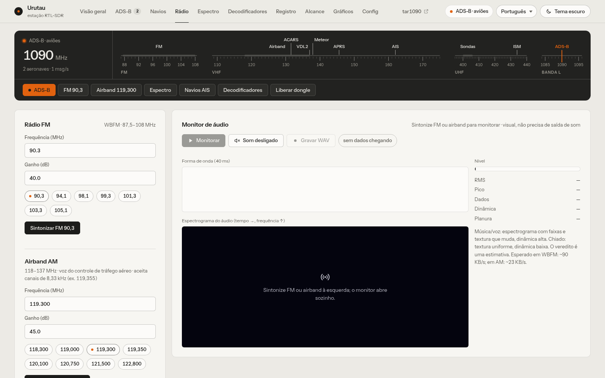
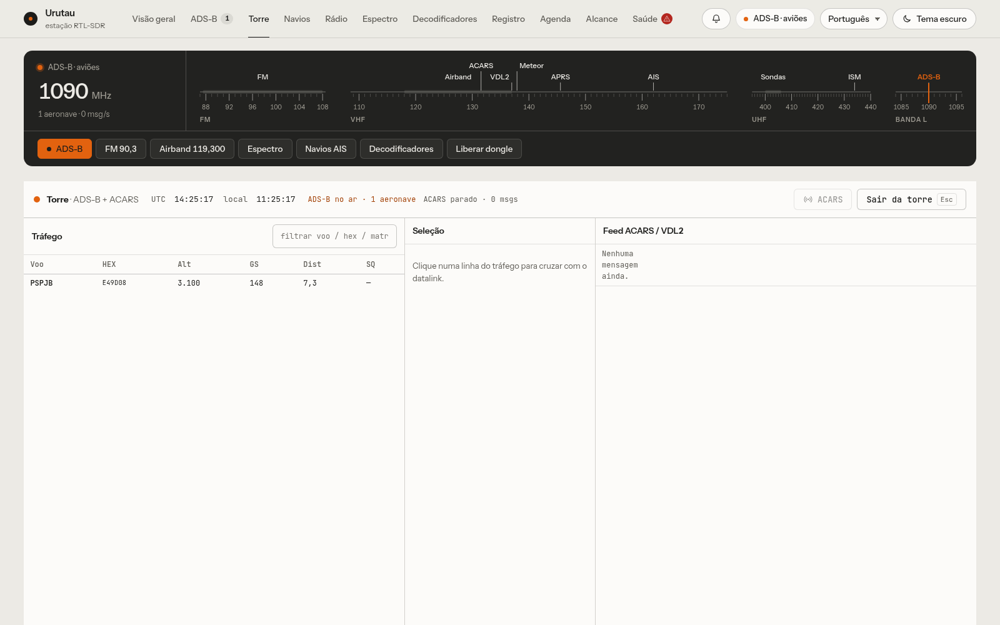
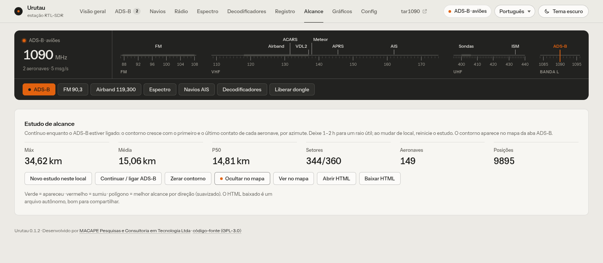

# Urutau

[](https://doi.org/10.5281/zenodo.24238099)

[](https://github.com/mateuspestana/urutau/releases)
[](https://github.com/mateuspestana/urutau/actions/workflows/ci.yml)
[](LICENSE)
[](https://github.com/mateuspestana/urutau/commits/main)

**Português** · [English](README.en.md) · [Español](README.es.md) · [Français](README.fr.md) · [Русский](README.ru.md)

O Urutau é uma estação de recepção de rádio para uso doméstico, baseada em um receptor RTL-SDR. Em um único painel web, ele reúne o rastreamento de aeronaves (ADS-B) e de embarcações (AIS), a escuta de rádio FM e da banda aeronáutica, a análise de espectro, a decodificação de mensagens digitais (ACARS, VDL2, APRS), o acompanhamento de radiossondas, a leitura de sensores sem fio e a recepção de imagens de satélites meteorológicos. Roda em Docker no Linux, no Raspberry Pi e, de forma experimental, no Windows. Todos os dados permanecem na máquina do usuário.

O nome vem do urutau (*Nyctibius griseus*), ave que passa a noite imóvel observando o céu.


## Motivação

Um receptor RTL-SDR de baixo custo cobre de 24 MHz a 1,7 GHz e capta dezenas de serviços diferentes. Cada serviço, porém, depende de um programa próprio, geralmente de linha de comando e em inglês, e apenas um desses programas pode usar o receptor de cada vez. Não havia um aplicativo que reunisse essas ferramentas e arbitrasse o acesso ao receptor. O Urutau preenche essa lacuna: o usuário escolhe o modo no painel, e o sistema encerra o processo anterior, libera o dispositivo USB e inicia o decodificador adequado.

O projeto se destina a quem quer observar o próprio espaço aéreo e marítimo sem depender de serviços de terceiros: pesquisadores, escolas, coletivos, associações de moradores e entusiastas de radioescuta.

## Funcionalidades

| Módulo | O que faz | Faixa |
|---|---|---|
| [ADS-B](#ads-b-aeronaves) | Aeronaves no mapa, com matrícula, tipo, altitude, velocidade e trilha | 1090 MHz |
| [Rádio FM](#rádio-fm-e-rds) | Emissoras comerciais, com nome e texto da emissora (RDS) | 87,5–108 MHz |
| [Banda aeronáutica](#banda-aeronáutica) | Comunicações de voz entre pilotos e controle de tráfego aéreo, em AM | 118–137 MHz |
| [Espectro](#espectro) | Varredura de qualquer faixa, com a frequência de cada pico identificada | 24–1700 MHz |
| [Navios (AIS)](#navios-ais) | Embarcações com nome, tipo, rumo, velocidade e destino | 161,975 e 162,025 MHz |
| [Datalink](#datalink-acars-e-vdl2) | Mensagens digitais ACARS e VDL2 entre aeronaves e estações de solo | 129–137 MHz |
| [APRS](#aprs) | Posições, dados meteorológicos e mensagens de radioamadores | 144–146 MHz |
| [Radiossondas](#radiossondas) | Balões meteorológicos com altitude, temperatura, umidade e trajetória | 400–406 MHz |
| [Sensores ISM](#sensores-ism-433-mhz) | Estações meteorológicas, termômetros e outros sensores sem fio | 433,92 MHz |
| [Satélites](#imagens-de-satélite-meteor-m) | Imagens dos satélites Meteor-M, veredito e SNR por passagem | 137,9 MHz |

Além dos receptores, o painel oferece [agenda](#agenda) (satélites, radiossondas, modos e gravação de áudio), [saúde](#saúde) do receptor e da antena, [alertas](#alertas) só no navegador, [registro de aeronaves](#registro-de-aeronaves), [estudo de alcance](#estudo-de-alcance), [torre](#torre-ads-b--acars) (consola ADS-B + ACARS), [dados](#dados) (exportação e retenção), [gráficos de desempenho](#gráficos), [marcadores](#marcadores), [instalação no celular](#instalar-no-celular-pwa) e interface em [cinco idiomas](#idiomas-e-aparência).

### Painel e escala de sintonia

O topo do painel reproduz a escala de um receptor de rádio. Cada serviço aparece na sua frequência real, distribuído em quatro faixas (FM, VHF, UHF e banda L), e um ponteiro laranja indica qual modo está com o receptor naquele momento. À esquerda, um mostrador exibe o modo e a frequência atuais; abaixo, as teclas de modo permitem trocar de serviço. Como o receptor atende a um serviço por vez, cada troca é feita pela própria API, que encerra o processo anterior antes de iniciar o novo. Depois de um reinício, a API retoma automaticamente o último modo escolhido.

### ADS-B (aeronaves)

As aeronaves transmitem continuamente, em 1090 MHz, sua identificação, posição, altitude e velocidade. O Urutau recebe esses sinais com o [readsb](https://github.com/wiedehopf/readsb) e os apresenta em um mapa no estilo do tar1090:

- ícones coloridos pela altitude e orientados pelo rumo, com trilha de cada voo;
- painel de detalhes com matrícula, modelo, operador, velocidade, razão de subida, piloto automático, vento e foto da aeronave;
- tabela ordenável e filtrável de todas as aeronaves recebidas;
- alerta para códigos de emergência (7500, 7600 e 7700);
- anéis de distância, rótulos e modo de acompanhamento de uma aeronave selecionada.

O mapa completo do tar1090 continua disponível em `http://localhost:8089` (proxy pelo painel; com senha ligada, vale o mesmo cookie da sessão).

### Rádio FM e RDS

O modo FM sintoniza emissoras comerciais em banda larga (WBFM) e decodifica o RDS, sistema pelo qual a emissora transmite seu nome, tipo de programação, texto livre, hora e frequências alternativas.

Como muitos computadores e servidores não têm saída de som, o áudio é apresentado visualmente, com osciloscópio, espectrograma, medidor de nível em dBFS e uma estimativa automática do conteúdo (voz e música, chiado ou silêncio). A reprodução no navegador é opcional, e o áudio pode ser gravado em WAV.



### Banda aeronáutica

O modo de banda aeronáutica recebe, em AM, as comunicações de voz entre pilotos e órgãos de controle (torre, aproximação, centro). Aceita canais com espaçamento de 8,33 kHz e utiliza o mesmo monitor visual de áudio do modo FM.

### Espectro

A análise de espectro varre qualquer intervalo de frequências com o `rtl_power` e desenha a potência recebida. O eixo horizontal é uma régua graduada, e cada pico significativo (8 dB acima da mediana) recebe um rótulo com a sua frequência. Ao passar o cursor, o gráfico mostra a frequência e o nível exatos. Há também um modo de cascata contínua, em que cada varredura vira uma linha colorida pela intensidade. Picos nas faixas de FM ou de banda aeronáutica podem ser sintonizados com um clique.


### Navios (AIS)

Embarcações transmitem, pelo sistema AIS, identificação, posição, rumo, velocidade e destino. O Urutau recebe os dois canais AIS ao mesmo tempo com o [AIS-catcher](https://github.com/jvde-github/AIS-catcher) e mostra as embarcações em um mapa, classificadas por categoria (carga, tanque, passageiros, pesca, recreio, rebocadores, auxílios à navegação), com trilha e ficha completa de cada uma. A recepção melhora muito com a antena voltada para o mar, uma baía ou um rio navegável.

### Decodificadores

A aba Decodificadores reúne os modos que transformam sinais digitais em dados estruturados. Cada um tem contadores de sessão, histórico em SQLite e a saída do programa decodificador para diagnóstico.

#### Datalink ACARS e VDL2

ACARS e VDL Modo 2 são os enlaces de dados pelos quais aeronaves e companhias aéreas trocam mensagens operacionais: posições, relatórios de motor, autorizações e mensagens CPDLC. O Urutau decodifica vários canais simultâneos (dentro de uma janela de 1,8 MHz) com o [acarsdec](https://github.com/TLeconte/acarsdec) ou o [dumpvdl2](https://github.com/szpajder/dumpvdl2) e apresenta as mensagens com sentido (solo ou aeronave), voo, matrícula, rótulo e texto, além do JSON completo de cada mensagem.


#### APRS

O APRS é a rede de radioamadores para posições, dados meteorológicos e mensagens curtas. O Urutau decodifica os pacotes com o [multimon-ng](https://github.com/EliasOenal/multimon-ng) e os interpreta com o aprslib. As estações aparecem em um mapa, com trilha, símbolo e comentário. A frequência padrão é 145,570 MHz (Brasil); estão disponíveis predefinições para 144,390 MHz (América do Norte), 144,800 MHz (Europa) e 145,825 MHz (Estação Espacial Internacional).

#### Radiossondas

Radiossondas são balões meteorológicos lançados duas vezes por dia, por volta de 00Z e 12Z, que transmitem posição, altitude, temperatura, umidade e pressão até estourarem a mais de 30 km de altitude. O Urutau executa o [radiosonde_auto_rx](https://github.com/projecthorus/radiosonde_auto_rx) em um container próprio e mostra no mapa cada sonda com a sua trajetória. A [agenda](#agenda) pode ligar a busca automaticamente nas janelas de lançamento; se uma passagem de satélite coincidir, o satélite preempta a sonda e a sonda retoma depois. O envio público de dados ao SondeHub permanece desligado.

#### Sensores ISM (433 MHz)

Na faixa ISM de 433,92 MHz operam estações meteorológicas domésticas, termômetros, sensores de pressão de pneus (TPMS), campainhas e controles remotos. O Urutau usa o [rtl_433](https://github.com/merbanan/rtl_433), que reconhece mais de 200 modelos, e organiza as leituras por dispositivo, com histórico de mensagens.

#### Imagens de satélite (Meteor-M)

Os satélites meteorológicos russos Meteor-M transmitem imagens da Terra em tempo real no formato LRPT, em 137,9 MHz. O Urutau calcula as passagens das próximas 48 horas a partir das órbitas publicadas pelo CelesTrak, com horário, duração, elevação máxima e trajetória. As capturas são decodificadas pelo [SatDump](https://github.com/SatDump/SatDump) e ficam disponíveis no próprio painel. Durante a passagem aparecem SNR ao vivo e pico; ao terminar, cada captura recebe um veredito:

| Veredito | Significado |
|---|---|
| imagem ok | a passagem gerou imagem |
| sinal fraco | o sinal chegou perto; uma antena externa deve bastar |
| sem sinal | o sinal nunca apareceu acima do ruído |
| interrompida | captura curta demais para avaliar |
| travou sem imagem | o decodificador sincronizou, mas não saiu imagem |

O pipeline LRPT padrão é **auto**: começa em 72k e, se após cerca de dois minutos houver SNR alto sem sincronismo, troca para 80k pelo restante da passagem. Capturas vazias podem ser apagadas pelo painel. A [agenda](#agenda) captura automaticamente toda passagem acima de uma elevação mínima e devolve o receptor ao modo anterior ao final.

O painel mostra um gráfico polar (SkyPlot) com o arco da passagem e a posição ao vivo do satélite, e uma galeria das capturas agrupadas por dia, com miniaturas e visualizador (zoom, baixar e apagar).

Para obter imagens, use antena externa com céu aberto. Um dipolo em V típico para 137 MHz tem braços de cerca de 53,4 cm, abertos a 120°, montados na horizontal com o eixo norte–sul (também serve uma QFH). Dentro de casa quase não sai imagem.

<!-- Imagem de uma passagem Meteor capturada pela estação: a ser adicionada. -->


### Registro de aeronaves

Toda aeronave recebida é registrada em um banco SQLite, inclusive as que não transmitem posição. Cada passagem gera uma linha, com horário, duração, voo, matrícula, tipo, altitude e distância máximas, intensidade do sinal e trilha. O registro pode ser filtrado por período e por texto, exportado em CSV e consultado no mapa. Um histórico de eventos da estação registra as trocas de modo, o que permite saber em que períodos o ADS-B esteve desligado.

### Estudo de alcance

Enquanto o ADS-B está ligado, o Urutau mede continuamente o alcance da estação em 360 setores de 1°, a partir do primeiro e do último contato de cada aeronave. O contorno resultante é suavizado (interpolação de lacunas, mediana circular e filtro gaussiano), de modo que uma aeronave isolada não produza um pico artificial; o valor máximo bruto continua disponível nas estatísticas. No mapa, o contorno, os pontos verdes (apareceu) e os vermelhos (sumiu) ligam e desligam cada um por si. O estudo também exporta um relatório HTML autônomo.

### Torre (ADS-B + ACARS)

A aba Torre é uma consola sem mapa: lista de tráfego ADS-B, detalhe do selecionado e feed ACARS/VDL2, com cruzamento por hex/voo/matrícula. Relógio UTC e local, selos de modo e atalho Esc para sair. Pensada para acompanhar o tráfego e o datalink na mesma tela.





### Gráficos

A aba Gráficos apresenta as séries históricas geradas pelo graphs1090: número de aeronaves, taxa de mensagens, sinal, alcance, uso de CPU, temperatura e memória, em períodos de 2 horas a 1 ano.

### Marcadores

Frequências e pontos geográficos de interesse podem ser salvos como marcadores. Marcadores de frequência são sintonizados com um clique; marcadores de posição aparecem no mapa.

### Alertas

Regras na aba Config (squawk de emergência, militar, voo baixo e perto, listas de hex/matrícula/voo, navio novo, radiossonda perto ou descendo, captura de satélite com imagem). O aviso fica só no navegador: sino com contador, toast e contador no título da aba. A API Notification do sistema é opcional e exige HTTPS ou `localhost` — sem Telegram nem e-mail.

### Agenda

A aba Agenda mostra quem pega o receptor nas próximas 48 horas: passagens de satélite, janelas de radiossonda e entradas suas (troca de modo ou gravação de áudio FM/airband em WAV no servidor). A prioridade é única → satélite → sonda → recorrente. Um satélite preempta uma sonda em curso e a devolve se a janela ainda estiver aberta. Os mesmos interruptores de captura automática de Meteor e de busca de sondas ficam nesta aba (e nas abas Satélites e Radiossondas há um atalho).

### Saúde

A aba Saúde reúne o diagnóstico do receptor e da antena: dongles USB detectados, avisos (driver de TV carregado, USB em uso, disco cheio, TLE antigo), status dos containers, uso de disco e uma medição de piso de ruído por faixa (FM, aeronáutica, Meteor, AIS, sondas, ISM e ADS-B). A medição pausa o ADS-B por cerca de um minuto e permite comparar antenas ou posições pelo delta em dB. O RTL-SDR Blog V4 tem TCXO (±1 ppm); calibração de PPM não é necessária.

### Dados

Na aba Config, a seção Dados lista cada conjunto gravado (passagens e posições ADS-B, eventos, datalink, AIS, APRS, ISM, sondas, alertas, alcance, saúde…): linhas, tamanho aproximado e exportação em CSV ou JSONL com filtro de data. A retenção por conjunto (padrão: nunca para passagens, posições e alcance; 90–365 dias para o restante; capturas de satélite vazias em 7 dias) roda diariamente por volta das 03:30; dá para simular o que seria apagado e executar “Apagar agora” com confirmação digitada. Nada sai da máquina. Parquet não vem na API (pyarrow aumentaria a imagem em mais de 10%); converta o CSV no host com DuckDB:

```bash
duckdb -c "COPY (SELECT * FROM read_csv('x.csv')) TO 'x.parquet'"
```

### Instalar no celular (PWA)

O painel é um Progressive Web App: manifesto, service worker (só o casco e os assets; nunca `/api/`) e instalação como aplicativo. Só funciona em contexto seguro (HTTPS ou `localhost`).

- **Android / Chrome:** menu → “Adicionar à tela inicial” (ou “Instalar aplicativo”).
- **iOS / Safari:** Compartilhar → “Adicionar à Tela de Início”.

Fora do `localhost`, use HTTPS. Na rede Tailscale, com o painel em `127.0.0.1:3090`, por exemplo `tailscale serve --bg 3090` (confira `tailscale serve --help` na sua versão). O mesmo HTTPS habilita as notificações do sistema do navegador.

### Idiomas e aparência

A interface está disponível em português (padrão), inglês, espanhol, francês e russo, com números e datas no formato de cada idioma. Há temas claro e escuro, e o painel se adapta a telas de celular. O instalador também fala os cinco idiomas, conforme o idioma do sistema.

## Requisitos

- **Receptor RTL-SDR.** O modelo de referência é o [RTL-SDR Blog V4](https://www.rtl-sdr.com/v4/), vendido com antenas dipolo. Com um dongle, o comportamento é o de sempre (um modo por vez). Dois dongles são opcionais: defina `URUTAU_ADSB_SERIAL` e `URUTAU_SDR_SERIAL` no `.env` para manter o ADS-B no ultrafeeder o tempo todo e rodar os demais modos no segundo receptor. Dois V4 saem de fábrica com o mesmo serial `00000001` — com um plugado por vez, `rtl_eeprom -d 0 -s 00000002` e reconecte. **Não validado em hardware.**
- **Computador:** Linux (Ubuntu, Debian, Fedora, Arch e derivados), Raspberry Pi 4 ou 5 com Raspberry Pi OS de 64 bits, ou Windows 10/11 com WSL2 (experimental).
- **Docker** com o plugin Compose.
- **Antena adequada ao serviço.** A antena que acompanha o receptor, em ambiente interno, atende ao FM e a aeronaves próximas. Navios, satélites e radiossondas exigem antena externa ou junto a uma janela, com visão do céu ou do mar.

O macOS não é suportado: o Docker no macOS não dá acesso a dispositivos USB.

## Instalação

### Linux e Raspberry Pi

```bash
git clone https://github.com/mateuspestana/urutau.git
cd urutau
./install.sh
```

O instalador:

1. verifica o Docker e o Docker Compose;
2. procura o receptor e, se necessário, oferece bloquear o driver de TV digital do kernel (`dvb_usb_rtl28xxu`), que costuma ocupar o dispositivo;
3. pergunta a localização da antena e quem pode abrir o painel: só esta máquina, a rede local e o Tailscale, ou só o Tailscale (nas opções de rede, pergunta também a [senha do painel](#senha-do-painel));
4. grava o arquivo `.env` e inicia os containers.

Ao final, o painel fica disponível em **http://localhost:3090**. Para instalação não interativa:

```bash
URUTAU_LAT=-15.799 URUTAU_LON=-47.864 ./install.sh -y
```

O instalador baixa imagens prontas para PC (amd64) e Raspberry Pi (arm64). Quando não há imagem para a arquitetura, ele compila localmente; em um Raspberry Pi, a compilação pode passar de uma hora.

### Windows (experimental)

No Windows, o Urutau roda dentro do WSL2, e o dongle é repassado ao Linux pelo [usbipd-win](https://github.com/dorssel/usbipd-win). O script `install-windows.ps1` automatiza o processo. Consulte o [guia para Windows](docs/windows.md).

### Acesso pela rede local e pelo Tailscale

Por padrão, o painel só abre no próprio computador. O instalador oferece três opções de acesso, gravadas em `URUTAU_BIND` no `.env`:

| Opção | `URUTAU_BIND` | Quem acessa |
|---|---|---|
| 1. Só esta máquina (padrão) | `127.0.0.1` | apenas o computador da estação |
| 2. Rede local e Tailscale | `0.0.0.0` | qualquer aparelho da rede local e da sua rede [Tailscale](https://tailscale.com) |
| 3. Só Tailscale | IP `100.x.y.z` da máquina | apenas aparelhos da sua rede Tailscale |

Com as opções 2 ou 3, abra `http://<endereço-da-estação>:3090` em outro aparelho (por exemplo, o nome ou o IP da máquina no Tailscale). Os links para o tar1090 e para os gráficos acompanham automaticamente o endereço usado e passam pelo mesmo proxy autenticado na porta `:8089`. A porta da API (`8000`) fica só em `127.0.0.1`. Na opção 3, o Tailscale precisa estar conectado antes de o Docker iniciar. Com senha ligada, só o admin troca o modo do receptor; a API controla o Docker da máquina: libere o acesso apenas em redes de confiança.

Se a máquina usa [ufw-docker](https://github.com/chaifeng/ufw-docker), o instalador (opções 2 e 3) acrescenta `100.64.0.0/10` na cadeia `DOCKER-USER`: o pacote só liberava redes locais (`10/8`, `172.16/12`, `192.168/16`), e sem a faixa Tailscale o painel abria na LAN e ficava inacessível pelos outros nós da rede Tailscale.

As notificações do sistema do navegador (API Notification) e a [instalação como PWA](#instalar-no-celular-pwa) só existem em HTTPS ou em `localhost`. Em `http://100.x.y.z` elas não aparecem; o sino, o toast e o título da aba continuam funcionando. Para HTTPS na rede Tailscale, com o painel só em `127.0.0.1:3090`, use por exemplo `tailscale serve --bg 3090` (confira `tailscale serve --help` na sua versão).

Para trocar a opção depois, execute `./install.sh` novamente ou edite `URUTAU_BIND` no `.env` e rode `docker compose up -d`.

### Senha do painel

Quando o painel fica aberto na rede (opções 2 ou 3), o instalador pede uma senha de administrador e, opcionalmente, uma de visitante. Elas ficam no `.env` como `URUTAU_PASSWORD` (admin) e `URUTAU_VIEW_PASSWORD` (visitante, só leitura). Sem nenhuma das duas definidas, a autenticação fica desligada — aceitável com `URUTAU_BIND=127.0.0.1`. O admin troca modo, salva config e edita a agenda; o visitante vê mapas, tabelas, gráficos e pode ouvir o áudio. A sessão usa o cookie `urutau_session` (HttpOnly, SameSite=Lax, 30 dias) e vale também em `:8089` (tar1090 e gráficos). Em instalação local (opção 1) o instalador não pergunta; dá para definir as senhas depois no `.env` e reiniciar com `docker compose up -d`.

## Operação

| Ação | Comando |
|---|---|
| Parar a estação | `docker compose stop` |
| Iniciar novamente | `docker compose start` |
| Atualizar | `git pull && ./install.sh` |
| Ver os registros da API | `docker compose logs -f api` |
| Documentação da API | http://localhost:3090/api/docs |

A localização da antena pode ser alterada a qualquer momento na aba Config. Três casas decimais (cerca de 100 m) bastam para o estudo de alcance.

## Privacidade e conexões externas

O painel é acessível apenas no próprio computador (`127.0.0.1`), a menos que o acesso pela rede local ou pelo Tailscale seja autorizado (veja [Acesso pela rede local e pelo Tailscale](#acesso-pela-rede-local-e-pelo-tailscale)). Nenhum dado de recepção é enviado a terceiros: o compartilhamento com redes de rastreamento (ADS-B Exchange, FlightAware e similares) e o envio de radiossondas ao SondeHub vêm desligados. A autenticação, a agenda e a aba Saúde operam só na máquina; o cookie de sessão não gera conexão externa.

O painel se conecta à internet apenas para obter informações que não podem ser geradas localmente:

| Finalidade | Serviço | Dado enviado |
|---|---|---|
| Órbitas dos satélites | CelesTrak | número do satélite (uma vez por dia) |
| Fundo do mapa | Esri (ou outro provedor), pela máquina do Urutau | z/x/y do bloco, uma vez por bloco (cache em `/data/tiles`); o navegador só fala com `/api/tiles` |
| Mapa offline (opcional) | arquivo PMTiles local em `/data/maps/` | nenhum |
| Matrícula e tipo das aeronaves | banco de dados distribuído com o tar1090 | prefixo do código da aeronave |
| Foto da aeronave, ao selecioná-la | planespotters.net | código e matrícula da aeronave |
| Aviso de nova versão (opcional) | GitHub Releases | se `update_check` estiver ligado em Config → Dados, consulta uma vez por dia; User-Agent `urutau-update-check`; nunca atualiza sozinho |

O relatório de alcance em HTML embute o Leaflet; não baixa biblioteca de CDN. Para um mapa offline, gere um recorte PMTiles (licença ODbL / atribuição OpenStreetMap e Protomaps) e coloque o arquivo em `/data/maps/` no volume da API:

```bash
pmtiles extract https://build.protomaps.com/<AAAAMMDD>.pmtiles regiao.pmtiles \
  --bbox=<oeste>,<sul>,<leste>,<norte>
```

Fontes e demais recursos do painel são distribuídos com o próprio software. A localização da antena fica apenas no arquivo `.env` e no volume Docker local.

## Arquitetura

```
receptor USB ─► ultrafeeder (readsb, tar1090, graphs1090) ─► ADS-B
             └► API (FastAPI) ─ rtl_fm, rtl_power, AIS-catcher, acarsdec, dumpvdl2,
                                rtl_433, multimon-ng, redsea, SatDump, radiosonde_auto_rx
                   │
                   └─► painel web (React + Vite, servido por nginx) em :3090
```

A API é a única responsável pelo receptor. A cada troca de modo, ela encerra o processo anterior, para ou inicia o ultrafeeder pelo Docker e só então inicia o novo decodificador. Os registros ficam em bancos SQLite no volume `urutau_api_data`. Instruções para desenvolvimento estão em [CONTRIBUTING.md](CONTRIBUTING.md).

## Solução de problemas

- **`usb_claim_interface error -6`:** outro programa está usando o receptor. Pode ser o driver de TV digital do kernel (execute `./install.sh` novamente) ou um programa externo como GQRX ou `rtl_*`. Antes de usar outro programa, pare a estação com `docker compose stop`.
- **Painel aberto, mas nenhuma aeronave:** com antena interna, é normal receber poucas aeronaves ou nenhuma. Para verificar o receptor, sintonize uma emissora FM: se o monitor de áudio mostrar sinal, o hardware está funcionando.
- **Permissão negada ao acessar o Docker:** confira se `DOCKER_GID` no `.env` corresponde ao resultado de `getent group docker`.
- **Satélites sem passagens:** defina a localização em Config e verifique se o container tem acesso à internet para buscar as órbitas.

## Aviso legal

A recepção de sinais transmitidos abertamente (ADS-B, AIS, FM, APRS, radiossondas e satélites meteorológicos) é uma prática comum de radioescuta. Comunicações de voz e mensagens de datalink não se destinam ao público: devem ser usadas apenas para estudo, sem divulgação do conteúdo. Cada usuário é responsável por observar a legislação do seu país.

## Créditos

O Urutau integra o trabalho de diversos projetos de código aberto: [docker-adsb-ultrafeeder](https://github.com/sdr-enthusiasts/docker-adsb-ultrafeeder) (readsb, tar1090 e graphs1090), [AIS-catcher](https://github.com/jvde-github/AIS-catcher), [acarsdec](https://github.com/TLeconte/acarsdec), [dumpvdl2](https://github.com/szpajder/dumpvdl2) e [libacars](https://github.com/szpajder/libacars), [rtl_433](https://github.com/merbanan/rtl_433), [multimon-ng](https://github.com/EliasOenal/multimon-ng), [redsea](https://github.com/windytan/redsea), [SatDump](https://github.com/SatDump/SatDump), [radiosonde_auto_rx](https://github.com/projecthorus/radiosonde_auto_rx), [Skyfield](https://rhodesmill.org/skyfield/) e [osmocom rtl-sdr](https://osmocom.org/projects/rtl-sdr).

## Como citar

Os metadados de citação estão em [CITATION.cff](CITATION.cff). No GitHub, use o botão *Cite this repository*. Em trabalhos acadêmicos, indique a versão utilizada e, quando disponível, o DOI da versão arquivada no Zenodo.

## Licença

Distribuído sob a [GNU General Public License v3.0](LICENSE) (GPL-3.0-only).

---

Desenvolvido por [MACAPE Pesquisas e Consultoria em Tecnologia Ltda](https://macape.dev).
