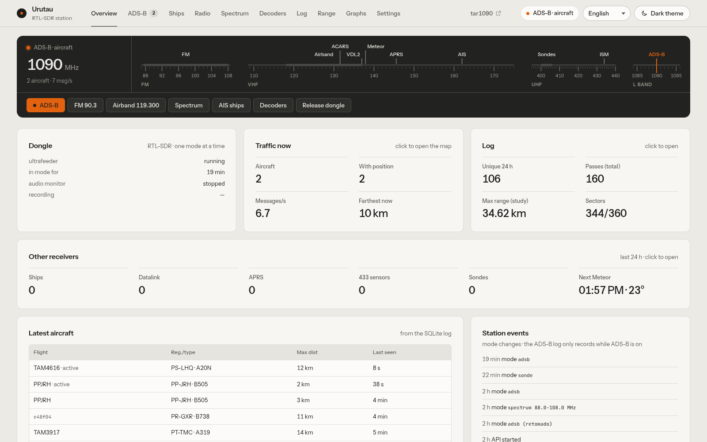
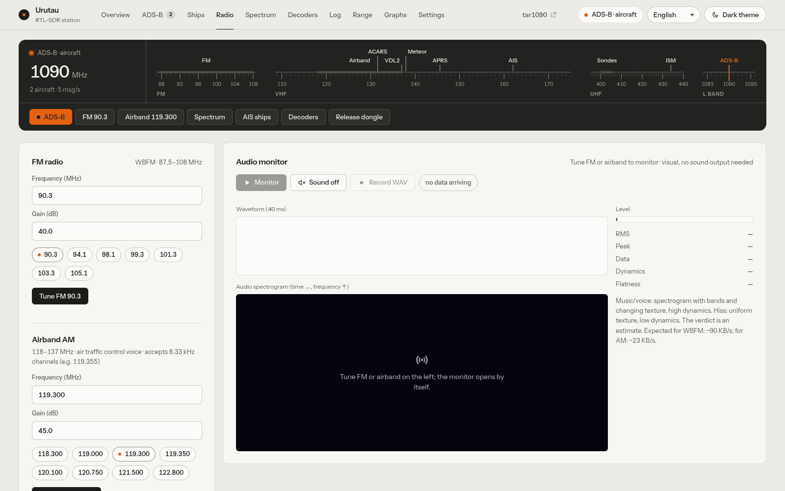
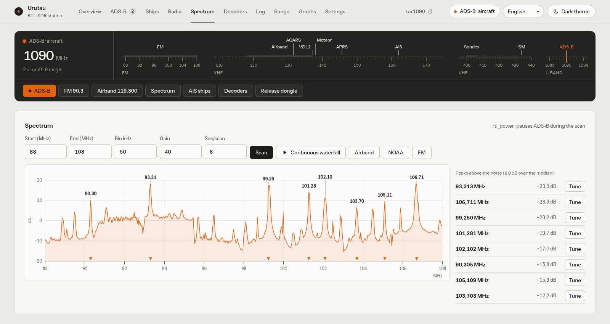
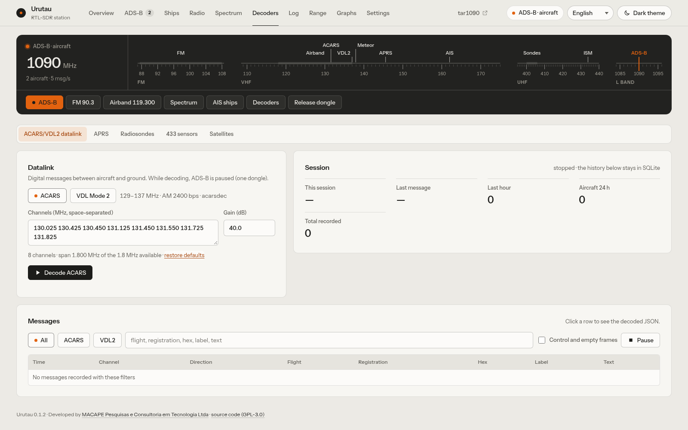
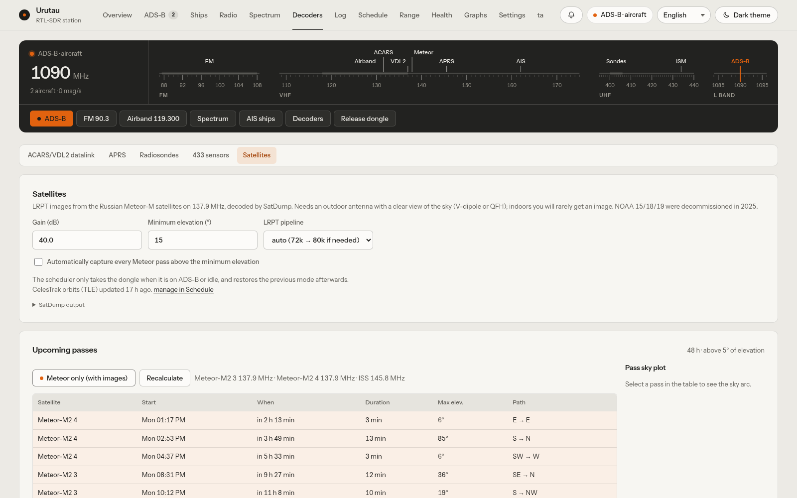
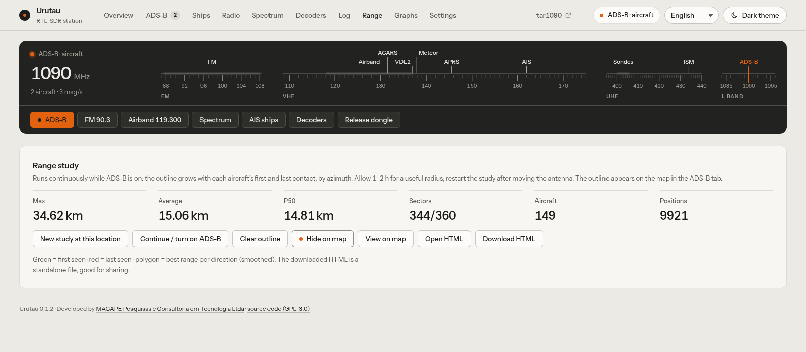

# Urutau

[](https://github.com/mateuspestana/urutau/releases)
[](https://github.com/mateuspestana/urutau/actions/workflows/ci.yml)
[](LICENSE)
[](https://github.com/mateuspestana/urutau/commits/main)

[Português](README.md) · [English](README.en.md) · [Español](README.es.md) · [Français](README.fr.md) · **Русский**

Urutau — домашняя станция радиоприёма на базе приёмника RTL-SDR. В одной веб-панели собраны отслеживание воздушных судов (ADS-B) и морских судов (AIS), прослушивание FM-радио и авиадиапазона, анализ спектра, декодирование цифровых сообщений (ACARS, VDL2, APRS), отслеживание радиозондов, чтение беспроводных датчиков и приём снимков метеорологических спутников. Работает в Docker на Linux, на Raspberry Pi и в экспериментальном режиме на Windows. Все данные остаются на компьютере пользователя.

Название дано в честь урутау, или серого лесного козодоя (*Nyctibius griseus*), — птицы, которая всю ночь неподвижно наблюдает за небом.



## Зачем это нужно

Недорогой приёмник RTL-SDR перекрывает диапазон от 24 МГц до 1,7 ГГц и принимает десятки разных служб. Однако для каждой службы нужна своя программа, обычно консольная, и приёмником может пользоваться только одна из них за раз. Приложения, которое объединяло бы эти инструменты и распределяло доступ к приёмнику, не существовало. Urutau закрывает этот пробел: пользователь выбирает режим в панели, а система останавливает предыдущий процесс, освобождает USB-устройство и запускает нужный декодер.

Проект предназначен для всех, кто хочет наблюдать за своим воздушным и морским пространством, не завися от сторонних сервисов: исследователей, школ, общественных объединений, местных сообществ и любителей радиоприёма.

## Возможности

| Модуль | Что делает | Диапазон |
|---|---|---|
| [ADS-B](#ads-b-воздушные-суда) | Воздушные суда на карте: регистрация, тип, высота, скорость и трек | 1090 МГц |
| [FM-радио](#fm-радио-и-rds) | Вещательные станции с названием и текстом станции (RDS) | 87,5–108 МГц |
| [Авиадиапазон](#авиадиапазон) | Голосовая связь пилотов с диспетчерами УВД, AM | 118–137 МГц |
| [Спектр](#спектр) | Сканирование любого диапазона с подписью частоты каждого пика | 24–1700 МГц |
| [Суда (AIS)](#суда-ais) | Морские суда: название, тип, курс, скорость и порт назначения | 161,975 и 162,025 МГц |
| [Линия передачи данных](#линия-передачи-данных-acars-и-vdl2) | Цифровые сообщения ACARS и VDL2 между бортом и землёй | 129–137 МГц |
| [APRS](#aprs) | Позиции, метеоданные и сообщения радиолюбителей | 144–146 МГц |
| [Радиозонды](#радиозонды) | Метеозонды: высота, температура, влажность и траектория | 400–406 МГц |
| [Датчики ISM](#датчики-ism-433-мгц) | Метеостанции, термометры и другие беспроводные датчики | 433,92 МГц |
| [Спутники](#спутниковые-снимки-метеор-м) | Снимки спутников «Метеор-М», вердикт и SNR по пролёту | 137,9 МГц |

Кроме приёмников, панель включает [расписание](#расписание) (спутники, радиозонды, режимы и запись звука), [здоровье](#здоровье) приёмника и антенны, [оповещения](#оповещения) только в браузере, [журнал воздушных судов](#журнал-воздушных-судов), [исследование дальности](#исследование-дальности), [графики](#графики), [метки](#метки) и интерфейс на [пяти языках](#языки-и-оформление).

### Панель и шкала настройки

Верхняя часть панели воспроизводит шкалу радиоприёмника. Каждая служба расположена на своей реальной частоте в одном из четырёх диапазонов (FM, VHF, UHF и L-диапазон), а оранжевая стрелка показывает, какой режим сейчас занимает приёмник. Слева индикатор показывает текущий режим и частоту, ниже находятся кнопки переключения режимов. Поскольку приёмник обслуживает одну службу за раз, каждое переключение выполняет API: сначала останавливается предыдущий процесс, затем запускается новый. После перезапуска API автоматически возвращается к последнему выбранному режиму.

### ADS-B (воздушные суда)

Воздушные суда постоянно передают на частоте 1090 МГц свой идентификатор, координаты, высоту и скорость. Urutau принимает эти сигналы с помощью [readsb](https://github.com/wiedehopf/readsb) и показывает их на карте в стиле tar1090:

- значки окрашены по высоте и повёрнуты по курсу, у каждого рейса есть трек;
- панель подробностей: регистрация, модель, эксплуатант, скорость, вертикальная скорость, автопилот, ветер и фото борта;
- сортируемая таблица с фильтром по всем принятым бортам;
- оповещение об аварийных кодах (7500, 7600 и 7700);
- кольца дальности, подписи и режим слежения за выбранным бортом.

Полная карта tar1090 по-прежнему доступна по адресу `http://localhost:8089` (прокси панели; при включённом пароле действует тот же cookie сессии).

### FM-радио и RDS

Режим FM принимает вещательные станции в широкополосном режиме (WBFM) и декодирует RDS — систему, через которую станция передаёт своё название, тип программы, произвольный текст, время и альтернативные частоты.

Поскольку у многих компьютеров и серверов нет аудиовыхода, звук отображается визуально: осциллограмма, спектрограмма, индикатор уровня в dBFS и автоматическая оценка содержимого (голос и музыка, шум или тишина). Воспроизведение в браузере необязательно, звук можно записать в WAV.



### Авиадиапазон

В режиме авиадиапазона в AM принимается голосовая связь пилотов с органами УВД (вышка, подход, районный центр). Поддерживается сетка каналов 8,33 кГц и тот же визуальный аудиомонитор, что и в режиме FM.

### Спектр

Анализатор спектра сканирует любой диапазон частот с помощью `rtl_power` и строит график принятой мощности. Горизонтальная ось — градуированная шкала, а у каждого значимого пика (на 8 дБ выше медианы) подписана частота. При наведении курсора отображаются точные частота и уровень. В режиме непрерывного водопада каждая развёртка превращается в строку, окрашенную по интенсивности. Пики в диапазонах FM и авиасвязи можно настроить одним щелчком.



### Суда (AIS)

Морские суда передают через систему AIS свой идентификатор, координаты, курс, скорость и порт назначения. Urutau принимает оба канала AIS одновременно с помощью [AIS-catcher](https://github.com/jvde-github/AIS-catcher) и показывает суда на карте по категориям (грузовые, танкеры, пассажирские, рыболовные, прогулочные, буксиры, средства навигационного оборудования) с треком и полной карточкой каждого. Приём заметно улучшается, если антенна обращена к морю, заливу или судоходной реке.

### Декодеры

На вкладке «Декодеры» собраны режимы, превращающие цифровые сигналы в структурированные данные. У каждого есть счётчики сеанса, история в SQLite и вывод программы-декодера для диагностики.

#### Линия передачи данных ACARS и VDL2

ACARS и VDL Mode 2 — линии передачи данных, по которым борта и авиакомпании обмениваются эксплуатационными сообщениями: координатами, отчётами о работе двигателей, разрешениями и сообщениями CPDLC. Urutau декодирует несколько каналов одновременно (в пределах окна 1,8 МГц) с помощью [acarsdec](https://github.com/TLeconte/acarsdec) или [dumpvdl2](https://github.com/szpajder/dumpvdl2) и выводит сообщения с направлением (земля или борт), рейсом, регистрацией, меткой и текстом, а также полный JSON каждого сообщения.



#### APRS

APRS — сеть радиолюбителей для передачи координат, метеоданных и коротких сообщений. Urutau декодирует пакеты с помощью [multimon-ng](https://github.com/EliasOenal/multimon-ng) и разбирает их библиотекой aprslib. Станции отображаются на карте с треком, символом и комментарием. Частота по умолчанию — 145,570 МГц (Бразилия); есть предустановки 144,800 МГц (Европа), 144,390 МГц (Северная Америка) и 145,825 МГц (Международная космическая станция).

#### Радиозонды

Радиозонды — метеозонды, которые выпускают дважды в сутки, около 00Z и 12Z. Они передают координаты, высоту, температуру, влажность и давление, пока не лопнут на высоте более 30 км. Urutau запускает [radiosonde_auto_rx](https://github.com/projecthorus/radiosonde_auto_rx) в отдельном контейнере и показывает каждый зонд на карте вместе с траекторией. [Расписание](#расписание) может автоматически включать поиск в окна запуска; если совпадает пролёт спутника, спутник прерывает зонд, а зонд возобновляется после. Публичная отправка данных в SondeHub отключена.

#### Датчики ISM (433 МГц)

В ISM-диапазоне 433,92 МГц работают бытовые метеостанции, термометры, датчики давления в шинах (TPMS), дверные звонки и пульты дистанционного управления. Urutau использует [rtl_433](https://github.com/merbanan/rtl_433), который распознаёт более 200 моделей, и группирует показания по устройствам с историей сообщений.

#### Спутниковые снимки («Метеор-М»)

Российские метеорологические спутники «Метеор-М» передают снимки Земли в реальном времени в формате LRPT на частоте 137,9 МГц. Urutau рассчитывает пролёты на ближайшие 48 часов по орбитам, публикуемым CelesTrak, с указанием времени, длительности, максимального угла места и траектории. Принятые сигналы декодирует [SatDump](https://github.com/SatDump/SatDump), а снимки доступны прямо в панели. Во время пролёта показываются текущий и пиковый SNR; по окончании каждая запись получает вердикт:

| Вердикт | Значение |
|---|---|
| снимок ok | пролёт дал изображение |
| слабый сигнал | сигнал был близок; наружной антенны должно хватить |
| нет сигнала | сигнал так и не поднялся над шумом |
| прервано | запись слишком короткая для оценки |
| синхронизация без снимка | декодер синхронизировался, но изображения нет |

Конвейер LRPT по умолчанию — **auto**: начинается с 72k и, если примерно через две минуты SNR высокий без синхронизации, переключается на 80k до конца пролёта. Пустые записи можно удалить из панели. [Расписание](#расписание) автоматически принимает каждый пролёт выше минимального угла места и затем возвращает приёмник в прежний режим.

Панель показывает полярный график (SkyPlot) с дугой пролёта и текущим положением спутника, а также галерею снимков по дням с миниатюрами и просмотрщиком (масштаб, скачивание и удаление).

Для снимков нужна наружная антенна с открытым небом. Типичный V-диполь на 137 МГц имеет плечи около 53,4 см, раскрытые на 120°, горизонтально, ось север–юг (подойдёт и QFH). В помещении снимок почти не получается.

<!-- Снимок пролёта «Метеора», принятый станцией: будет добавлен. -->



### Журнал воздушных судов

Каждый принятый борт записывается в базу SQLite, включая те, что не передают координаты. На каждый пролёт создаётся строка со временем, длительностью, рейсом, регистрацией, типом, максимальными высотой и дальностью, уровнем сигнала и треком. Журнал можно фильтровать по периоду и тексту, экспортировать в CSV и просматривать на карте. История событий станции фиксирует смену режимов, поэтому видно, в какие периоды ADS-B был выключен.

### Исследование дальности

Пока включён ADS-B, Urutau непрерывно измеряет дальность приёма станции в 360 секторах по 1° по первому и последнему контакту каждого борта. Полученный контур сглаживается (интерполяция пропусков, круговая медиана и гауссов фильтр), чтобы одиночный борт не создавал ложного пика; исходный максимум остаётся доступным в статистике. Контур можно показать на карте и экспортировать как автономный HTML-отчёт.



### Графики

Вкладка «Графики» показывает исторические ряды, которые строит graphs1090: число бортов, частоту сообщений, сигнал, дальность, загрузку процессора, температуру и память за периоды от 2 часов до 1 года.

### Метки

Частоты и интересующие точки на карте можно сохранить как метки. Частотная метка настраивается одним щелчком, метка позиции отображается на карте.

### Оповещения

Правила задаются во вкладке «Настройки» (аварийный squawk, военный борт, низкий и близкий полёт, списки hex/регистрации/рейса, новый корабль, радиозонд рядом или снижающийся, снимок спутника с изображением). Уведомление остаётся только в браузере: колокольчик со счётчиком, toast и счётчик в заголовке вкладки. Системный Notification API необязателен и требует HTTPS или `localhost` — без Telegram и электронной почты.

### Расписание

Вкладка «Расписание» показывает, кто занимает приёмник в ближайшие 48 часов: пролёты спутников, окна радиозондов и ваши собственные записи (смена режима или запись звука FM/авиадиапазона в WAV на сервере). Приоритет: разовое → спутник → зонд → повторяющееся. Спутник прерывает идущий зонд и возвращает его, если окно ещё открыто. Те же переключатели автозахвата «Метеора» и поиска зондов находятся на этой вкладке (со ссылкой из «Спутники» и «Радиозонды»).

### Здоровье

Вкладка «Здоровье» собирает диагностику приёмника и антенны: обнаруженные USB-донглы, предупреждения (загружен ТВ-драйвер, USB занят, диск заполнен, устаревший TLE), состояние контейнеров, использование диска и измерение уровня шума по диапазонам (FM, авиа, Meteor, AIS, зонды, ISM и ADS-B). Измерение примерно на минуту приостанавливает ADS-B и позволяет сравнивать антенны или места установки по дельте в дБ. У RTL-SDR Blog V4 есть TCXO (±1 ppm); калибровка PPM не нужна.

### Языки и оформление

Интерфейс доступен на португальском (по умолчанию), английском, испанском, французском и русском языках, числа и даты форматируются по правилам каждого языка. Есть светлая и тёмная темы, панель адаптируется к экранам телефонов. Установщик тоже работает на пяти языках, следуя языку системы.

## Требования

- **Приёмник RTL-SDR.** Эталонная модель — [RTL-SDR Blog V4](https://www.rtl-sdr.com/v4/), который продаётся с дипольными антеннами. С одним донглом поведение прежнее (один режим за раз). Второй донгл необязателен: задайте `URUTAU_ADSB_SERIAL` и `URUTAU_SDR_SERIAL` в `.env`, чтобы ADS-B всегда оставался на ultrafeeder, а остальные режимы шли на втором приёмнике. Два V4 с завода имеют один и тот же serial `00000001` — с одним подключённым устройством выполните `rtl_eeprom -d 0 -s 00000002` и переподключите. **Не проверено на железе.**
- **Компьютер:** Linux (Ubuntu, Debian, Fedora, Arch и производные), Raspberry Pi 4 или 5 с 64-битной Raspberry Pi OS либо Windows 10/11 с WSL2 (экспериментально).
- **Docker** с плагином Compose.
- **Антенна, подходящая для службы.** Штатной антенны приёмника в помещении достаточно для FM и ближайших бортов. Для судов, спутников и радиозондов нужна наружная антенна или антенна у окна с видом на небо или море.

macOS не поддерживается: Docker в macOS не даёт контейнерам доступа к USB-устройствам.

## Установка

### Linux и Raspberry Pi

```bash
git clone https://github.com/mateuspestana/urutau.git
cd urutau
./install.sh
```

Установщик:

1. проверяет Docker и Docker Compose;
2. ищет приёмник и при необходимости предлагает запретить драйвер цифрового ТВ ядра (`dvb_usb_rtl28xxu`), который часто занимает устройство;
3. спрашивает местоположение антенны и кто может открывать панель: только этот компьютер, локальная сеть и Tailscale или только Tailscale (в вариантах сети также спрашивает [пароль панели](#пароль-панели));
4. записывает файл `.env` и запускает контейнеры.

После завершения панель доступна по адресу **http://localhost:3090**. Установка без вопросов:

```bash
URUTAU_LAT=-15.799 URUTAU_LON=-47.864 URUTAU_LANG=ru ./install.sh -y
```

Установщик загружает готовые образы для ПК (amd64) и Raspberry Pi (arm64). Если для архитектуры образа нет, он собирает его локально; на Raspberry Pi сборка может занять больше часа.

### Windows (экспериментально)

В Windows Urutau работает внутри WSL2, а донгл передаётся в Linux с помощью [usbipd-win](https://github.com/dorssel/usbipd-win). Скрипт `install-windows.ps1` автоматизирует процесс. См. [руководство для Windows (на английском)](docs/windows.en.md).

### Доступ из локальной сети и через Tailscale

По умолчанию панель открывается только на самом компьютере. Установщик предлагает три варианта доступа, которые сохраняются в `URUTAU_BIND` в файле `.env`:

| Вариант | `URUTAU_BIND` | Кто имеет доступ |
|---|---|---|
| 1. Только этот компьютер (по умолчанию) | `127.0.0.1` | только компьютер станции |
| 2. Локальная сеть и Tailscale | `0.0.0.0` | любые устройства локальной сети и вашей сети [Tailscale](https://tailscale.com) |
| 3. Только Tailscale | IP компьютера `100.x.y.z` | только устройства вашей сети Tailscale |

В вариантах 2 и 3 откройте `http://<адрес-станции>:3090` на другом устройстве (например, по имени или IP компьютера в Tailscale). Ссылки на tar1090 и графики автоматически используют тот же адрес и идут через тот же аутентифицированный прокси на порту `:8089`. Порт API (`8000`) слушает только на `127.0.0.1`. В варианте 3 Tailscale должен подключаться раньше запуска Docker. При включённом пароле режим приёмника меняет только admin; API управляет Docker компьютера: открывайте доступ только в доверенных сетях.

Системные уведомления браузера (Notification API) есть только при HTTPS или на `localhost`. На `http://100.x.y.z` они не появляются; колокольчик, toast и заголовок вкладки продолжают работать. Для HTTPS в сети Tailscale, если панель слушает только `127.0.0.1:3090`, используйте например `tailscale serve --bg 3090` (проверьте `tailscale serve --help` для вашей версии).

Чтобы сменить вариант позже, снова запустите `./install.sh` или измените `URUTAU_BIND` в `.env` и выполните `docker compose up -d`.

### Пароль панели

Когда панель открыта в сети (варианты 2 или 3), установщик спрашивает пароль администратора и, по желанию, пароль гостя. Они сохраняются в `.env` как `URUTAU_PASSWORD` (admin) и `URUTAU_VIEW_PASSWORD` (гость, только чтение). Если ни один не задан, аутентификация выключена — это нормально при `URUTAU_BIND=127.0.0.1`. Admin меняет режим, сохраняет настройки и правит расписание; гость видит карты, таблицы и графики и может слушать звук. Сессия использует cookie `urutau_session` (HttpOnly, SameSite=Lax, 30 дней) и действует также на `:8089` (tar1090 и графики). В варианте «только этот компьютер» установщик не спрашивает; пароли можно задать позже в `.env` и перезапустить через `docker compose up -d`.

## Эксплуатация

| Действие | Команда |
|---|---|
| Остановить станцию | `docker compose stop` |
| Запустить снова | `docker compose start` |
| Обновить | `git pull && ./install.sh` |
| Журналы API | `docker compose logs -f api` |
| Документация API | http://localhost:3090/api/docs |

Местоположение антенны можно изменить в любой момент на вкладке «Настройки». Трёх знаков после запятой (около 100 м) достаточно для исследования дальности.

## Конфиденциальность и внешние подключения

Панель доступна только с самого компьютера (`127.0.0.1`), если не разрешён доступ из локальной сети или через Tailscale (см. [Доступ из локальной сети и через Tailscale](#доступ-из-локальной-сети-и-через-tailscale)). Данные приёма не передаются третьим лицам: обмен с сетями отслеживания (ADS-B Exchange, FlightAware и подобными) и отправка радиозондов в SondeHub по умолчанию отключены. Аутентификация, расписание и вкладка «Здоровье» работают только на машине; cookie сессии не создаёт внешних подключений.

Панель подключается к интернету только для получения сведений, которые нельзя получить локально:

| Назначение | Сервис | Что передаётся |
|---|---|---|
| Орбиты спутников | CelesTrak | номер спутника (раз в сутки) |
| Подложка карты | Esri (или другой провайдер), через машину Urutau | z/x/y тайла, один раз на тайл (кэш в `/data/tiles`); браузер обращается только к `/api/tiles` |
| Офлайн-карта (по желанию) | локальный файл PMTiles в `/data/maps/` | ничего |
| Регистрация и тип бортов | база данных из комплекта tar1090 | префикс кода борта |
| Фото борта при выборе | planespotters.net | код и регистрация борта |

HTML-отчёт о дальности встраивает Leaflet и не качает библиотеку с CDN. Для офлайн-карты сделайте вырезку PMTiles (лицензия ODbL / атрибуция OpenStreetMap и Protomaps) и положите файл в `/data/maps/` в томе API:

```bash
pmtiles extract https://build.protomaps.com/<ГГГГММДД>.pmtiles region.pmtiles \
  --bbox=<запад>,<юг>,<восток>,<север>
```

Шрифты и прочие ресурсы панели поставляются вместе с программой. Местоположение антенны хранится только в файле `.env` и в локальном томе Docker.

## Архитектура

```
USB-приёмник ─► ultrafeeder (readsb, tar1090, graphs1090) ─► ADS-B
             └► API (FastAPI) ─ rtl_fm, rtl_power, AIS-catcher, acarsdec, dumpvdl2,
                                rtl_433, multimon-ng, redsea, SatDump, radiosonde_auto_rx
                   │
                   └─► веб-панель (React + Vite, отдаётся nginx) на :3090
```

За приёмник отвечает только API. При каждой смене режима оно останавливает предыдущий процесс, останавливает или запускает ultrafeeder через Docker и лишь затем запускает новый декодер. Данные хранятся в базах SQLite в томе `urutau_api_data`. Инструкции для разработчиков — в [CONTRIBUTING.md](CONTRIBUTING.md).

## Решение проблем

- **`usb_claim_interface error -6`:** приёмник занят другой программой. Это может быть драйвер цифрового ТВ ядра (запустите `./install.sh` ещё раз) или внешняя программа, например GQRX или `rtl_*`. Прежде чем запускать другую программу, остановите станцию командой `docker compose stop`.
- **Панель открыта, но бортов нет:** с комнатной антенной это нормально. Чтобы проверить приёмник, настройтесь на FM-станцию: если аудиомонитор показывает сигнал, оборудование исправно.
- **Нет доступа к Docker:** проверьте, что `DOCKER_GID` в `.env` совпадает с выводом `getent group docker`.
- **Нет пролётов спутников:** укажите местоположение в настройках и убедитесь, что у контейнера есть доступ к интернету для загрузки орбит.

## Правовая оговорка

Приём открыто передаваемых сигналов (ADS-B, AIS, FM, APRS, радиозонды и метеоспутники) — распространённая практика радиоприёма. Голосовая связь и сообщения линии передачи данных не предназначены для публики: используйте их только в учебных целях и не разглашайте их содержание. Каждый пользователь сам отвечает за соблюдение законодательства своей страны.

## Благодарности

Urutau опирается на работу многих проектов с открытым исходным кодом: [docker-adsb-ultrafeeder](https://github.com/sdr-enthusiasts/docker-adsb-ultrafeeder) (readsb, tar1090 и graphs1090), [AIS-catcher](https://github.com/jvde-github/AIS-catcher), [acarsdec](https://github.com/TLeconte/acarsdec), [dumpvdl2](https://github.com/szpajder/dumpvdl2) и [libacars](https://github.com/szpajder/libacars), [rtl_433](https://github.com/merbanan/rtl_433), [multimon-ng](https://github.com/EliasOenal/multimon-ng), [redsea](https://github.com/windytan/redsea), [SatDump](https://github.com/SatDump/SatDump), [radiosonde_auto_rx](https://github.com/projecthorus/radiosonde_auto_rx), [Skyfield](https://rhodesmill.org/skyfield/) и [osmocom rtl-sdr](https://osmocom.org/projects/rtl-sdr).

## Как цитировать

Метаданные для цитирования находятся в [CITATION.cff](CITATION.cff). На GitHub используйте кнопку *Cite this repository*.

## Лицензия

Распространяется на условиях [GNU General Public License v3.0](LICENSE) (GPL-3.0-only).

---

Разработано [MACAPE Pesquisas e Consultoria em Tecnologia Ltda](https://macape.dev).
